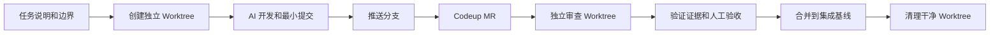

# 城瘾 AI 协作开发与 Worktree 工作流

> 状态：启用中 · 更新：2026-07-12 · 适用：`chengyinhub-xcx`、`chengyinhub-admin`、`chengyinhub-ui` 与跨端任务

## 目标

让 Codex、编码助手 与人工可以并行推进独立任务，同时保证每项改动可审查、可验证、可放弃、可回滚；Worktree 用于隔离，Codeup Merge Request（MR）用于审核与合并，二者都不等于部署。

## 当前基线与历史盘点

当前集成基线为 `master`（2026-07-12 起由原 `feature/app-backend-support` 快进转正，`origin/HEAD` 已指向 master；原分支退居二线）。主目录常驻 `master`；不在主目录直接启动新的 AI 改动任务，一律用 Worktree。

以下历史 Worktree 均干净、无独立提交，但基线停在 `5a58e322`，低于当前集成基线。默认保留，不再分派新任务；确认无保留价值后可人工清理：

| Worktree | 分支 | 状态 |
|---|---|---|
| `[历史工具路径或分支标识已移除]` | `api-bugfix` | 历史待清理 |
| `[历史工具路径或分支标识已移除]` | `game-mode-redesign` | 历史待清理 |
| `[历史工具路径或分支标识已移除]` | `merchant-admin-audit` | 历史待清理 |
| `[历史工具路径或分支标识已移除]` | `release-audit` | 历史待清理 |
| `[历史工具路径或分支标识已移除]` | `ui-consistency` | 历史待清理 |

## 目录与分支规范

```text
/Users/arlan/Downloads/chengyin/                         当前集成工作目录；避免并行开发
/Users/arlan/Downloads/chengyin-worktrees/               新任务的唯一 Worktree 根目录
  xcx-merchant-coupon/                                   feature/xcx-merchant-coupon
  api-order-refund/                                      feature/api-order-refund
  review-feature-xcx-merchant-coupon/                    detached 审查目录
```

| 类型 | 命名 | 用途 |
|---|---|---|
| 小程序功能 | `feature/xcx-<task>` | 页面、交互、端内契约 |
| 后端功能 | `feature/api-<task>` | Controller/Service/Mapper/迁移文件 |
| 管理后台 | `feature/admin-<task>` | RuoYi UI 或业务后台 |
| UI 设计系统 | `feature/ui-<task>` | 仅视觉和组件规范 |
| 测试/审查 | `feature/qa-<task>` | 回归、测试或只读审查 |
| 紧急修复 | `fix/<task>` | 从明确基线创建，优先完成与合并 |

一个任务只能有一个主要目标。路由、全局配置、权限/RBAC、数据库 migration、设计 token、依赖清单属于公共文件：同一时段只允许一项任务修改，其他任务必须基于合并后的新基线再启动。

## 标准执行流程



### 1. 开任务

先复制 [[AI任务说明模板]]，写清目标、非目标、可改文件、禁止改动区和验收命令。再创建 Worktree：

```bash
scripts/worktree-manager.sh create feature xcx-merchant-coupon
```

命令默认从 `master` 创建 `feature/xcx-merchant-coupon`。如需指定基线，显式传入第三个参数；不要在当前主目录直接修改。

### 2. 开发与提交

在新 Worktree 内完成任务。每个可验收阶段只暂存该任务文件，提交信息使用 `feat/fix/test/docs(scope): 中文摘要`。推送只代表代码进入 Codeup，不代表后端部署或小程序上线。

### 3. MR 与审查

向 `master` 创建 Codeup MR，并使用 [[MR验收清单]]。审查者必须在 detached Worktree 中复核，而非在开发目录直接切分支：

```bash
scripts/worktree-manager.sh review feature/xcx-merchant-coupon
```

审查最少覆盖：任务边界、关键成功与失败路径、权限/归属校验、测试证据、无关变更和回归风险。

### 4. 合并与清理

仅在你查看 MR diff 和验证证据后合并。合并后，在集成分支运行受影响模块的检查；确认 Worktree 干净后才清理：

```bash
scripts/worktree-manager.sh cleanup /Users/arlan/Downloads/chengyin-worktrees/xcx-merchant-coupon
```

该命令拒绝强制删除、拒绝删除根目录外 Worktree，因此不会静默丢弃未提交内容。

## 并行容量与任务分配

日常最多同时运行三项：

| 槽位 | 允许任务 | 约束 |
|---|---|---|
| A：交付 | 一个小程序或后台功能 | 不改公共基础设施 |
| B：修复 | 一个边界明确的 bug | 不与 A 修改相同文件 |
| C：审查 | 只读审计、测试、MR Review | 不直接混入功能改动 |

先合并接口/数据契约，再创建依赖它的前端任务；先合并公共 UI token，再创建页面视觉任务。遇到同一文件冲突，不并行硬合：保留一个任务继续，另一个任务 rebase 到新基线后再处理。

## 日常节奏

1. 上午：确定最多三项独立目标，并分别填写任务说明。
2. 开发中：每项只在自己的 Worktree 操作；用 `status` 查看全局状态。
3. 收尾：提交、推送、创建 Codeup MR；由另一 Agent 或人工在审查 Worktree 验证。
4. 合并后：清理 Worktree，保留 MR、提交 SHA 和测试证据作为回滚与追溯依据。

```bash
scripts/worktree-manager.sh status
```

## 禁止事项

- 不在包含未知未提交改动的集成目录启动新任务。
- 不让多个任务同时修改路由、权限、migration、全局 token 或依赖清单。
- 不用 `git worktree remove --force` 清理 AI 任务目录。
- 不把“已 push / 已合并”误认为“已部署 / 已上线”。
- 不把多个不相关功能塞进一个 MR。

## 相关文档

- [[AI任务说明模板]]
- [[MR验收清单]]
