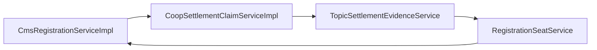
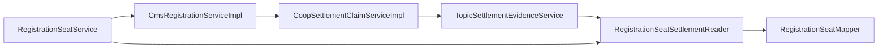

# P1：席位结算读边界导致整应用启动失败

状态：已证实；窄读修补在55b9候选的实际隔离JAR启动验证通过，生产未部署。不能扩大为全系统无环证明。

失败来源：`3e976bcefb2a14b19600e6bc4a20029767d58b75`，[标准 CI 的真实隔离启动](https://github.com/liboyang42-cpu/hengyin/actions/runs/40130007237/job/120979619091)。JUnit XML 无 failure/error，Spring 完整应用仍因下列真实依赖环拒绝启动。未开启循环引用，未部署。

根因是结算证据读取依赖了同时承接报名核销命令的席位服务。上层结算只需要原席位事实，却因此带入报名命令、权限和回调依赖，跨域读取的依赖方向不合适。这属于真实装配边界缺陷，既有局部 Spring 测试没有完整包含该环。

G 修补源：`4e5ee6e1acafa5cd4efbf366c29445d5d5c1249e`。增加唯一同域窄读类 `com.chengyinhub.business.service.RegistrationSeatSettlementReader`；构造只依赖原 `RegistrationSeatMapper`。`verifiedSeatsForGroup(Long, Long, Date)` 保持原 MANDATORY/rollbackFor、scope 检查、先查历史多人证据不足再当前锁读核销事实的顺序、原 409 错误。原 Mapper/XML 字节不改；它不承担资金资格判断。

旧席位服务保留同签名兼容委托，结算证据直接依赖 reader。没有新外部依赖、接口框架、SQL 或迁移，不引入 Lazy/Provider，不放宽鉴权、不启用 circular references。原时间窗、席位去重、单人证明、逐核销席位费用、原冻结分项与负利润人工规则均保持。

施工和验收：G 同时更新直接夹具并补 4 个 reader 单测源码；原席位真库用例内增加 reader 读回，声明数不增加。F 保留原 33 个场景，补两项真实反向环负控及实际托管对象逐跳/同实例/MANDATORY断言（共35场景源码），并登记精确类型/消费者。只有完整冻结候选的编译、相关原 MySQL 断言、实际 Spring 管理对象和完整隔离 JAR 启动均通过，才能关闭本 P1；测试/fixture double 不代替整应用启动。

实施成本局限于一个窄读类、原服务委托、结算注入与直接测试装配，不扩展重构其他域。没有 schema/data 迁移成本。回滚需回到经过完整启动验证的整套候选；单独撤回窄读边会恢复该环，不应作为故障恢复方式。生产未部署，当前无需执行任何回滚操作。

长期约束：结算消费席位域的窄读合同；席位命令仍由原 owner 承接。CI 保留精确 Mapper 消费者约束和真实完整启动门，新增业务不靠开启循环引用获得装配成功。自动静态零阻断不等于实际 Spring 图无环。

实际关闭证据仅绑定`55b9e722fcfeeb118781a35ad077ed23849f86b0`：run40132354873/attempt2/job120988405767的完整startup步骤SUCCESS；日志21:19:23确认packaged application ready、MySQL/RedisUP、缓存往返、protectedHTTP401、jobs disabled。对应原XML的35个Spring场景、4个reader、3个ASR屏障均通过。后续两个旧Python夹具仍失败，编译结构/JAR身份后置步骤被跳过，因此整体流水线仍未签收。
