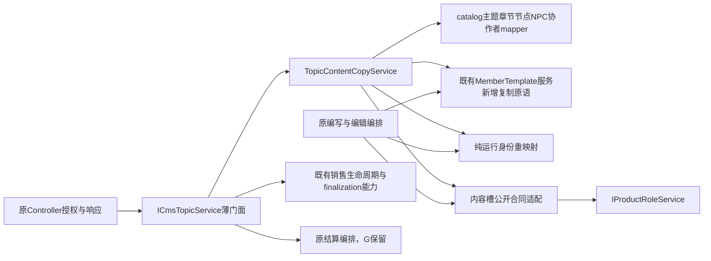

# WP10 首片：完整主题内容复制用例迁移方案（仅文档）

结论：选择「使用公开主题模板，给明确作用域会员复制完整内容（copyType=3），提交后返回新 topicId」作为首个表征用例；迁出同一复制实现，保留官方复制、普通复制及俱乐部移交的既有入口合同。复制应用服务拥有新主题内容图的写入编排，不依赖主题大服务、销售生命周期或资金服务。此交付没有实施生产代码，也没有证明机械迁移已等价；需要 root 按下列精确范围分配后才能编码。

## 1. 来源、隔离与本轮证据

- 唯一仓库：`liboyang42-cpu/hengyin`，观察基线 **ad7e59fbf6a20e85e741318afe654c5411bf1101**，公开 tree **7426dd108301e3dbe7d8c1a4623e6209dfbcc8d1**。
- 本轮独立目录 `/workspace/architecture-day-d-wp10-copy-design`，分支 `codex/architecture-day-d-wp10-copy-design`。原工作区全部保留。该本地文档 worktree 的初始 HEAD 为公共原基线 `2ec68899099a1e250df0949a8383bf85b5d3ffe0`；**没有用这里的旧生产源码审计 ad7e**。本报告读取的是从 ad7e 的公开 tree/blob 恢复并逐文件校验的只读快照；远端文档候选以 ad7e 为唯一 parent，覆盖范围只限本目录。
- 已读取公开 `docs/delivery/architecture-day/COORDINATOR/governance-scope.md`（blob `083ffae0db6c6c02d019de1b1766e786a2a9af4a`），包括 WP01、WP10、Q5、T14、T15。WP10 要分离数据写权与编排方向，包迁移最后；本方案不把包装 Controller lambda、保留大服务内部实现或新增反向依赖计作完成。
- 全量源码快照：2,438 个 main Java、1,934 个 test Java、281 个 mapper XML；另核对 2,762 个前端 JS/TS/Vue 与相关文档/IT schema，共 **7,415 个文件 Git blob 匹配，0 不符**。公开递归 tree 未截断。未扫描编译产物、运行时动态 bean、线上配置或外部调用方。
- `PRODUCTION_CALLERS.csv`：58 个接口方法的 **192 个直接/方法引用/显式 ObjectProvider 调用点，55 个调用文件**。另有四个 Orient service 通过 `OrientOwnership` 传递 service 引用，七处传递见 `FORWARDED_CALLERS.json`；加接口及实现声明共 61 个类型引用文件。不是将引用文件数冒充调用数。`INTERNAL_METHODS.json` 为 207 个词法方法定义及名称级反向分析资料，非 Java 类型绑定证明。
- 本轮实际执行仅 Python 只读检索、Git blob/SHA256 校验及文档校验。**Java、MySQL、Spring 容器、旧/新行为对照、完整 CI 均未执行**。root 告知 full CI40039894119 与 C10/E6 run40039899867 当时运行中，不能当作已通过证据。W19、signup 已冻结；此前 W19 的 29 项真库结果不外推到本用例。

文中行号全部指 ad7e，不套用旧基线。核心源码 `CmsTopicServiceImpl` blob 为 `9686e2e983ce139c6593cfe9692b42bcdbfdc4de`，接口 blob 为 `dc8518034b80e71118e751aacf48bf312dc021c4`；107 个关键来源文件及完整 SHA256 在 `SOURCE_FINGERPRINTS.json`。

## 2. 为什么先 copy，而不是发布或结算

当前同一个 `CmsTopicServiceImpl` 同时保存内容图、重建编辑内容、验证/冻结发布、处理销售期限、执行结算及合作款发放。copy 的失败传播、模板归属和图身份映射却只是其中一个完整内容用例；它的本地写入能在一个事务内闭合，生产闭包没有通知、支付、语音克隆或资金账本调用，因此比发布/销售切片更易保持边界。

copy 不是「只复制几列」：它需要主题→章节→节点→私有模板→节点 NPC→各类 JSON 引用的身份迁移，最后复制协作者并返回新身份。只移动 HTTP 包装或基本字段方法而保留这些写入在大服务里，不解决 owner 问题。反过来，copy 也不应取得下架原主题、绑定俱乐部、发布审核、报价、售卖、结算或退款的写权。

既有能力要保留：`advanceSaleLifecycle()`（454）已委托 `TopicSaleLifecycleAdvancer`，后者逐主题事务并锁原主题；`TopicSaleFinalizationServiceImpl.finalizeForSale()`（115）拥有 `selectCmsTopicByIdForUpdate`、商业冻结快照与 PRICING→SELLING CAS。本片不引入另一套 sale finalization，不把其锁、金额或冻结规则移入 catalog。将来资金只经明确的冻结内容查询合同读取 catalog；本片不新建该共同 fence/schema，也不声称解决全部 WP10。

## 3. 所有现有复制入口及授权边界

| 入口/调用者 | 当前合同 | 迁移后保留位置 |
|---|---|---|
| `ApiTopicTemplateController.use` 146 → `useTemplateForMember` 179 → `copyCmsTopic` 184 | 登录正整数 principal；模板 `selectTopicIsTemplate=1`；merchant scope 必须 `PROJECT_MANAGE` 且复制归属 merchant owner，普通 scope 归本人；传明确 `memberId`、`copyType=3`；响应 `data.topicId` | Controller 原授权/响应保持；薄门面进入完整复制应用服务 |
| `CmsTopicController.copy` 108–121 → `copyOfficialCmsTopic` 114 | `business:topic:copy`、受托可见范围；拒绝 body.memberId；来源 `isPlatformOwned`；新内容槽 PLATFORM、配置平台账号；响应原 `success(Long)`，异常映射原样 | HTTP 权限仍在原 Controller；官方来源/归属检查必须在新应用服务，不能仅靠门面或 Controller |
| `ApiTopicController.transferToClub` 1273–1315 → `transferToClub` 1310 | 登录/merchant 项目 owner 解析；主题 owner；俱乐部存在；本人主理且有效 leader，或已有通过的合作邀约；响应 `data.newTopicId` | 整个移交编排与权限不迁 |
| `CmsTopicServiceImpl.transferToClub` 471 → 自调用 `copyCmsTopic` 476 | 外层同一事务，明确 member，copyType=2；新主题绑定 club，原主题下架，同步创意帖隐藏；任一步失败回滚复制 | 外层事务不拆；自调用门面再调用新 bean，REQUIRED 加入原事务 |

公开模板 eligibility 在 `CmsTopicMapper.xml` 1168：`del_flag=0 and is_template=1 and status=1 and user_status=1`，不是仅检查模板标记，也不要求 VERIFIED。该查询仍在 Controller 调用之前；通用 copy 服务本身只拒绝源不存在/软删，没有模板资格复验或通用 actor 解析。**不把服务本身宣称为完整鉴权门。** 是否为模板 eligibility 与复制之间新增原子资格 fence 属 root 的后续决策，本轮不补锁/不改权限。

前端路径核对：后台 `src/views/business/topic/index.vue` 1097 → `src/api/business/topic.js` 193（无 body，默认 copyType=1）；小程序 `pages/template/index.js` 690/748、`pages/square/utils/topic-template-remix.js` 6 调 `/api/template/topic-template/use`；`pages/topic/index/index.js` 1273 调 transfer。没有发现其他生产 Java copy 入口；全接口查询/写调用仍逐行列出，不能因为本片只迁 copy 就删掉其他门面方法。这里的“全部”限定于所钉住的公开源码与显式调用，不能证明不存在外部 HTTP 调用。

## 4. 事务、执行顺序与失败合同

原 `copyCmsTopic` 464、`copyOfficialCmsTopic` 503、`transferToClub` 471 均 `@Transactional(rollbackFor=Exception.class)`，默认传播 REQUIRED、默认隔离；copy 源查询不是 FOR UPDATE。当前顺序：

1. 官方入口先拒绝 member 参数，再判断 PLATFORM 来源。通用入口不新增此判断。
2. 普通 mapper 读源主题，拒绝缺失/`delFlag=2`。`Convert.toInt(copyType,1)` 保留解析规则；`>=2` 才图复制、`>=3` 才协作者。没有范围枚举校验；零/负值也只复制基本资料，不能在机械移动中悄悄改成枚举。null/非法字符串默认值是现有可观测行为，不是本方案新增 fallback。
3. 构建新主题、设置目标 owner，`insertCmsTopic==1` 且 generated id>0；之后原 public role 服务登记内容槽。PLATFORM 必须读回 `(entityType=PLATFORM, entityId=null)`，否则抛错。
4. 按 mapper 原返回顺序校验并插入章节，建 old→new 章节表；复制节点/模板/NPC，再回填 unlock、模板内 NPC/节点引用。
5. 回填 theme runtime、BRANCH_GRAPH、章节 blocks；再回填主题 JourneyStory；同作者完整副本按节点数校验并规范化 completeRule。
6. copyType>=3 复制 `cms_collaborators`，返回新 topicId。只有事务提交后才是本地复制成功。

新应用服务两个公开入口仍 REQUIRED/rollbackFor Exception，门面保留注解。**禁止 REQUIRES_NEW、在 Controller 新起事务、把 mapper 写放 afterCommit、捕获后返回成功。** 从 transfer 调入时须加入原事务；原主题下架失败也回滚新主题、章节、模板、NPC、槽与协作者。保留 DAO 执行顺序，不把读源改锁读，不新增 member/图锁序或缓存。

已有行数检查不缩水：主题/章节/节点必须一行且有效 generated identity；NPC 一行且非 null id；节点 unlock 与章节 blocks >0；runtime、graph、模板引用、story、completion rule 各为一行。**当前模板 insert 只检查 id 非 null，不检查行数；协作者 insert 未检查行数**，这是现状缺口，不可写成已经有完整 fail-closed 证明。需另设注入异常与返回0的表征测试，若 root 决定收紧，单列正确性补丁，不混入“纯机械等价”。

多次合法 copy 本来产生多个新 topic；它没有幂等事件号/重放回执。前端 single-flight 测试只约束在途重复点击，不能当服务端幂等。此次不引入永久事件身份，也不在返回丢失后推定上一笔未复制。

## 5. 字段与图的真实复制合同

### 5.1 主题：手工白名单，不是 BeanUtils 全复制

| 类别 | 当前字段/行为（609–672、518–564、567–589） |
|---|---|
| 原内容带入 | `topicType,productType,circleThemeCode,gameModuleConfigJson,journeyRulesJson,themeRuntimeConfigJson,journeyStoryJson,topicId,name,subtitle,description,addressName,totalTime,totalMileage,locationCount,templateCount,startDate,endDate,imgUrl,imgArr,categoryIds` |
| 来源链 | `sourceTemplateTopicId` 优先继承原值，否则有 circleThemeCode 时取源 id，否则 null；这不同于 `sourceTopicId`，不能互换 |
| owner | 初值配置 platformMemberId；官方固定该值+PLATFORM 槽；通用明确 memberId 时覆盖并声明 MEMBER 槽。通用缺 memberId 的遗留分支不落内容槽，仅告警；所有已发现活跃通用调用均明确 memberId，后台走独立官方入口 |
| 初始路线 | `routeMode=LINEAR,routeGraphJson=null,configVersion=1`；完整复制取得节点映射后才写新 BRANCH_GRAPH（expectedVersion=targetVersion=1） |
| 显式状态/审计重置 | `status=0,userStatus=0,merchantStatus=0,delFlag=0,isSync=0,isRecommend=0,checkStatus=0,isSettlement=0`；reason、merchantSignUpStart/EndDate 置 null；create/updateBy=system_copy，分别 new Date |
| 条件回填 | 同作者、copyType>=2 且 completeRule 非空，源/新节点数相同后才经既有 policy 回填。跨作者/基本复制不带通关规则，且未自动带 completeRewardCouponId |
| 未显式赋值/依赖 DB 默认 | `isDraft,isTemplate,lifecycle,betaFlag,publishedConfigVersion,publishedRouteGraphJson,publishedThemeRuntimeConfigJson,clubId,publishMode,selfPlay,selfPlayPrice,selfPlayQuota,teamMode,teamMaxMembers,xpBudget,finishMedalName/Img,completeRewardCouponId,saleEndAt,sellingStartedAt,sourceTopicId,recruitDeadline,roamReferralEnabled` 等白名单外字段；不得从注释推断它们被主动清理 |

`insertCmsTopic`（XML865）动态列：字段 null 通常不出现在 insert；`reason=null` 不等于向旧行写 SQL NULL（这里是新行）。`isRecommend` 虽赋0，insert 里未列它；`isDraft/isTemplate/betaFlag` 也未列。仓库 IT schema 给 lifecycle/isDraft/isTemplate/betaFlag 默认0、publishedConfigVersion默认0，但**未对生产 schema 做预检**。因而“生成草稿”准确含义是新内容未审核/未上架、且按 schema 默认生命周期；不能声称 `is_draft=1`。迁移不能顺手补列/补状态。

### 5.2 章节、节点、模板、NPC、协作者

| 对象 | 保持与重置 | 身份/边界 |
|---|---|---|
| 章节（679–806） | 带 name/description/blocks/atmospherePreset/audio/img/总时长里程点数模板数/sort/category/categoryId/recruitEnabled/perkMinValue/allowedValidationMethods/maxNodeXp/maxMerchant/required/terms/circle 字段；maxMerchant null→0；时间/by新值 | topicId换新；每章旧新映射。合法 recruitment/product/category/terms 校验逐章原顺序。REVSHARE **一律**转 PERK、maxPerHeadFee清空（包括当前官方复制）；不能依据已过时注释改变资金资格规则 |
| circle候选 | 带 candidateCode/role/policy；来源被认作 circle模板时 circleEnabled=0，否则 source null→1 或保留原值 | 不复制商家已确认阵容或商业快照 |
| 节点（846–989） | 带 name/description/address/经纬/img/nodeTime/businessTime/hookText/cardHookLong/fragmentText/status/sortId/xpValue；新 UUID 去连字符作为 checkinCode，新by/time | 主题/章节换新，缺章映射当前写0；不复制 merchantMemberId/nodeAudit*。unlock 后置映射；源外 unlock 告警并不带过去。源章节列表为空会提前返回，连孤儿节点也不复制；不得在本片暗修 |
| 私有模板（1028–1058） | 原 BeanUtils 内容字段/状态原样带入；换id/owner，originalTemplateId只继承公共库来源或0，isSync=0，新by/time | 不同 owner 或含 NPC/sys node refs 强制独立复制；一次复制同源模板只复制一次。同 owner 无引用可共享。无模板/未知 owner/模板不存在当前保留原id。runtime.templateBindings 的 templateId 必须与源节点相符，再替换为新id，不能“修正”伪造绑定 |
| 模板引用 | 副本 advancedConfig 的 NPC/system node refs 经 NarrativeNpcRefs/StateKeyRefs 重写；新模板更新一行 | 绝不写源模板以适配新节点。需要独立模板却只有源id且含节点条件时抛错；只含NPC的未知owner分支当前仅告警保留来源，列入决策缺口 |
| 节点NPC（997–1017） | scopeType=4/scopeId新node；name/avatar/persona/greeting/sort/auditStatus/enabled；persona/greeting null→空串、sort null→0 | source NPC id换新；仅 VOICE_READY且voiceId非空继承voiceId/status/sample，其余VOICE_NONE，不克隆语音、不复制在途任务。门店 scope2 不复制；映射不到的引用由既有helper置空并告警 |
| 协作者（1063–1088） | 读dataType=1/dataId源，带原dataType/memberId，dataId新主题，新by/time | 是内容协作者记录，不是coopInvite/coopOrder/票种/结算受益人。原循环没有insert结果断言 |

节点/章节 mapper 原查询按 `sort_id asc`，同 sort 值顺序没有额外 id tie-breaker；不能在迁移中重排。`OWN_C03_20` 已守住真实generated identity映射，不能用新旧列表下标配对。

### 5.3 JSON 与“快照”含义

完整复制须保持：章节 blocks 的 materialized nodeId 与 beat NPC；route graph 节点及合法出口校验（含不可迁移 ticket 引用拒绝）；JourneyStory node/chapter/NPC；theme runtime 的 node/chapter/NPC/template binding；gameplay runtime facilityKey/settlementSlot、quest、template tool/plan provenance。先获得真实新身份，再用既有 `ChapterFlowCompiler`、`TopicRouteConfigValidator`、`JourneyStory`、`ThemeRuntimeConfig`、`NarrativeNpcRefs`、`StateKeyRefs`、`GameplayTemplateRules`，不另写 JSON 迁移器。

这里是**同事务内容图拷贝**，不是销售冻结快照或玩家运行快照。`updateRouteDefinition` XML1081 只改新草稿定义及configVersion；copy 不调用 `publishRouteSnapshot`、`freezePublication`，不带 published runtime/graph，不新增sale snapshot、session、订单/回执。源多次普通读是否为一致快照依赖实际事务隔离与 schema；当前未验证并发编辑/软删竞态，不能仅凭注解宣称已冻结同一内容版本。需要新 fence 的决定由 root/A/B/G 统一，不混入移动补丁。

## 6. 精确接口、依赖方向与文件 owner（建议，尚未授写权）

保留全部 `ICmsTopicService` 现有签名/Controller协议/实体序列化/MyBatis resultMap。新包仍用既有 `business.service/impl/support`，不跨 Maven 模块改包。拟新增接口：

```java
// catalog 内部应用合同；不是新的 HTTP API，也不暴露 forcedContentEntityType。
interface ITopicContentCopyService {
    Long copyCmsTopic(Long id, Map<String, Object> params);
    Long copyOfficialCmsTopic(Long id, Map<String, Object> params);
}
// 既有 ICmsMemberTemplateService 增加明确内容owner复制原语；不发布/提审/分发模板。
Long copyForContentOwner(Long templateId, Long ownerMemberId, boolean forceCopy);
```

Map 的 Convert、默认值、异常与参数拒绝保留在应用服务，不能让门面另作一种解析。私有模板 cache 仍是每次操作局部 Map；新模板原语不保存跨请求缓存、不自行开启新事务，不改变原BeanUtils字段/时间/行数判定。`ICmsMemberTemplateService` 既有 insert/update 会重置时间，不能简单改成调它们而宣称逐字段等价；新原语移动原mapper实现，现有写路径不改。

| 文件/方法 | 建议编写 owner 与精确改动 | 保持只读 |
|---|---|---|
| 新 `service/ITopicContentCopyService.java`、`impl/TopicContentCopyServiceImpl.java` | catalog-copy/D（root分配后）；拥有两个完整入口，原17个方法构成的可达闭包中，复制专用编排、校验与写入全部迁出 | 不注入 ICmsTopicService、资金/销售/review/通知服务、transactionManager；不接受调用回大服务的lambda/helper |
| `CmsTopicServiceImpl` | root共享文件单一合并；仅两入口改注入代理委托、移除复制专用方法；三类共享helper改委托；保留门面Tx | transfer整方法、所有create/edit/publish/销售/资金算法不迁；`platformMemberId`、共享mapper字段、RouteNodeMaps不能据copy需求整删 |
| 新应用服务的复制专用方法 | `copyCmsTopicWithContentOwner`518、`preserveSameOwnerCopiedCompletionRule`567、`copyTopicBasicInfo`609、`copyChaptersAndNodes`679、`assertCopiedChapterRecruitment`809、`assertCopiedChapterSupplyTerms`826、`copyNodes`846、`copyNodeNpc`997、`copyCollaborators`1063、`remapCopiedJourneyStory`3694 | `selectCmsTopicById`1884原样留门面；新服务调同一个mapper纯查询，不反调门面；`nullToEmpty`5143可用本地同等工具，不迁其公共使用点 |
| `ICmsMemberTemplateService` / `CmsMemberTemplateServiceImpl` 新 `copyForContentOwner` | catalog-template owner（建议本片由root交D）；移动1028原语实际mapper操作。大服务原`copyTemplateForOwner`只保留每操作cache/委托包装，供编辑重建用；新copy同样局部缓存 | `remapRebuiltTemplateNodes`3872算法不移；现有模板publish/edit/review方法不改。禁止编辑反调copy应用服务 |
| 新 `support/TopicTemplateRuleIdentityRemapper` | catalog纯规则owner；移动3890的无DBJSON转换；copy与原新建4148/编辑4706的helper均只委托它 | 原玩法helper/JSON格式不改、不移发布冻结逻辑 |
| 新 `support/TopicPlatformContentSlotGuard` | catalog→roles适配owner；仅复用 `IProductRoleService.declareContentSlot + activeContentSlot` 及596既有读回条件/异常；大服务官方新建与新copy共用 | 不改IProductRoleService/ProductRoleMapper及G资金规则，不自行新增required MEMBER/历史补槽规则 |
| copy map局部值对象 | copy服务私有 `CopiedContentIds` 只保存chapterOldToNew/oldToNew；方法内NPC/template map仍原生命周期 | 原 `$RouteNodeMaps`5853含authoring的client/opening/ending字段且有反射测试，完整保留；不让copy依赖编辑内部类型 |
| `CmsTopicMapper`/Chapter/Node/NPC/Collaborators XML、domain/DTO/VO、所有 Controller、ScheduleUtils | 无生产写权申请；本片只读 | 禁止一次性改resultMap/列/schema/接口序列化/调度注册/资金owner文件 |

其中三项共享helper的反向调用证据：`copyTemplateForOwner`被copyNodes及`remapRebuiltTemplateNodes`3872使用；`remapTemplateRuleIdentities`被copy679、新建4148、重建4706使用；`declareRequiredPlatformContentSlot`被copy518和官方新建2008使用。不是为了抽象而新建服务，而是阻断「编辑→copy→大服务」的真实环，并把模板写权留给现有模板域。guard只适配角色公开合同，不取得角色表直写权。



新增依赖只能为上图方向。新copy不得依赖 F/OLD/S/MONEY；roles/template实现当前不依赖主题门面，必须实际构造Spring bean证实无新环。已有 AuditTaskService ObjectProvider→主题发布回写的环本片不扩散、不宣称已治理。

## 7. T14 表征与迁移验收（全部待执行）

首选完整 fixture：公开可用 circle/BRANCH_GRAPH 模板，至少两章（相同 sort值）、三个节点、共享跨作者私有模板、一个强制同作者模板、materialized blocks、unlock、节点NPC（READY/PENDING各一）、门店NPC引用、JourneyStory、runtime binding、gameplay tools/设施/任务、协作者。源数据同时带已有销售/资金/发布字段以验证不泄漏；主用例 copyType=3、明确普通/merchant owner，并分别执行官方默认基本复制与transfer copyType2兼容路径。

同一夹具在**旧ad7e与新候选两个隔离scratch库/相同schema**执行，不能在一个库连跑后比较自增值或让新实现验证自身预期。固定输入、clock策略、排序来源；预先保存原版本源码/mapper身份，生产包中不留双轨开关。采集原响应/异常类别、语义、完整所有相关行及零写表前后差分，记录真实调用顺序/事务边界。

| 表征组 | 必须断言 |
|---|---|
| T14-C01 完整模板使用 | Controller普通/merchant解析均保持；new topicId对应提交后的全部图/模板/NPC/协作者；源主题/模板/节点/槽完整不变；返回没有“已发布/已售卖/已送达”含义 |
| C02 官方/默认/解析 | 官方非PLATFORM/指定member/删除源均拒绝、零新行；PLATFORM槽未落库抛错回滚；null/缺/Long/string copyType及1/2/3/>3/<1旧新合同记录，不能只留成功新case |
| C03 图身份 | 相同sort、共享模板只一副本、同owner共享/强制、不变digest与新bindingID；unlock/blocks/story/route/runtime/tool每条引用追踪到新身份；非法图/ticket来源引用/伪binding拒绝且回滚 |
| C04 字段 | 主题/章节/节点/NPC/模板/协作者白名单与重置；实际MySQL默认值；同作者completeRule保留与跨作者不带奖励引用；REVSHARE降级、circle候选、VOICE_READY与非READY |
| C05 分阶段失败 | 新topic/第2章/node/NPC/generatedID/模板id/graph/runtime/blocks/story/completeRule patch失败；每个异常后全部新图/模板/角色槽/协作者零行，原对象不变；零行未检查路径只记录现状，不伪造为已fail-closed |
| C06 transfer传播 | 真copy加入外层；新club绑定失败/原主题下架失败/创意帖更新异常时包括所有复制内容一起回滚；不能继续stub掉copy而宣称传播已覆盖 |
| C07 拒绝与非目标表 | 登录/merchant权限/模板资格/CMS scope/club关系拒绝均copy未调用；所有订单、票、注册、库存、资金流水、coop settlement、sale snapshot、player runtime、通知intent/消息和外部provider动作增量0 |
| C08 重复及源并发 | 重复请求合法地产生两个独立图，不能共享新节点/模板变更；源编辑/软删竞态记录实际隔离行为，与旧实现比较；没有达成新fence安全性则不声称达成 |
| C09 四线交叉回归 | 原新建/编辑重建的模板复制及运行身份映射、官方新建槽读回；原publish审核/快照；销售/结算既有回归不变。只迁copy还不能宣称四线分离完成 |

仅允许归一化：新生成 topic/chapter/node/template/NPC/collaborator/role 的 surrogate ID（按源身份建立映射，不按位置），checkinCode具体随机值（仍须新值/合法/唯一），本次create/update时间。**不可归一化** member/owner/角色主体、source lineage、source字段、status/flags、商业金额/费率/限额、模板digest、节点内容/顺序、图连线或异常结果；不可把多余行、缺字段、告警、UNKNOWN当噪声滤掉。source rows在排除明确transfer下架/帖可见性后逐列不变。

需要实证：真实MySQL+生产mapper+Spring事务代理的完整copy闭包，明确 opt-in scratch前提、失败硬红、root登记CI并保存逐XML/表差分/cleanup。不能用H2或Mockito结果替代；此文档不新增测试框架/依赖/schema。若现有IT schema缺完整角色/route/runtime列，先提交夹具最小差异供root审查，绝不更改生产DDL以配合测试。

## 8. 现有测试及不能外推的边界

`EXISTING_TESTS.json` 列出22个关键词命中测试类及case名；命中可来自注释或源码边界字符串，不等于22个完整复制suite，更不等于本轮通过。

- `TopicCopyJourneyRulesTest`、`TopicCopyNpcRemapTest`、`TopicCopyRecruitmentGuardTest`、`TopicCopyTemplateOwnershipTest`、`ChapterFlowCopyTest`、`TopicJourneyStoryCarryTest`、`CopyTopicCopyTypeNpeTest`、`TopicOfficialCopyBoundaryTest`：主要是直接new服务+Mockito mapper/反射注入，覆盖规则/引用/拒绝。事务注解存在断言不能证明已经回滚。迁移后将用例直接构造新应用服务，保留一组旧门面委托验证，不能为fixture便利保留旧生产双实现或添加假fallback。
- `OWN_C03_19/20/22/23`：同作者规则、真实生成身份、tied sort、失败ID、story节点重映射；必须保留case/关键断言及旧缺陷再现，不用重写预期吞掉差异。
- `TopicTransferToClubTest`：Controller权限及H2/MySQL-mode事务代理；两个持久化用例的 **copyCmsTopic被spy替身插一行**，没有真实章节/模板/NPC/角色槽复制。因此不足以证明新bean加入原事务的完整真库回滚。
- `TopicInsertColumnCoverageMyBatisIT`：源码使用真实MySQL/生产Topic XML，守lifecycle/recruitDeadline/journey字段和动态默认；属于mapper覆盖，不是完整copy。此处仅读源码，未运行，历史注释不能作为本次执行证据。
- `CmsTopicControllerScopeTest`、`CmsTopicCreatePublisherBoundaryTest`、`ApiTopicTemplateMerchantOperatorScopeTest` 及transfer权限case保留。新app不能拿掉官方来源检查后仅依赖这些mock Controller测试。
- `ProductSourceWiringTest`、`RevshareGateWiringTest`、`TopicLifecycleWiringTest` 读取旧源码文件/方法分界；迁移需只更新copy断言的所属文件/精确调用链，保留产品type/章节字段/内容槽先于章节以及非copy现金方法断言。不能增加扫描白名单或删除断言。`OWN_C03_05/25` 反射 `$RouteNodeMaps`，本片原类不删。
- 前端 `template-shelf-config-entry-contract.test.js`、`topic-transfer-to-club-single-flight.test.js` 保留copy返回导航与重复提交实际行为；不能把客户端防连点外推为服务端exactly-once。

## 9. Q5/T15 三项变更演练与完成口径

当前只能交可执行的演练设计，**未完成真实代码演练或依赖差分验收**。根在迁移候选稳定后执行并保存逐文件diff/回归/依赖边差分：

| 常规变更 | 演练操作与允许影响 | 失败判据 |
|---|---|---|
| 新玩法局部规则 | 在已有玩法公开policy中增加一个工具身份映射fixture；只改该policy及声明公开fixture/adapter，运行复制+原编辑重建case，copy app不用编辑内部实现 | 需改资金/销售服务内部写侧或让编辑依赖copy app；图引用回旧节点 |
| 新通知通道 | 在Notify域现有公开合同/adapter增加受控通道fixture；copy图迁移源diff应为0、原copy外部动作仍0；若选择发布通知演练须由发布owner另行授权 | 为新通道修改copy/funds内部，或将无通知copy硬加通知以凑演练 |
| 新统计查询 | catalog查询侧增加仅按新主题/owner聚合的只读fixture，通过既有查询合同/视图给统计adapter；复制与资金写侧diff为0 | 直接改copy事务/资金mapper写侧计算统计，新增跨域写或依赖环 |

T15不是“没动文件所以自动通过”；要记录变更的所属模块、声明的公开适配及运行输出。此片交验至少须C01–C09表征和新增依赖反向禁止检查通过；整体WP10仍需发布/编辑/销售/结算各自迁移、WP04冻结查询合同与WP01真实门禁。

## 10. 上线、回退与需要root决定的事项

本片机械移动不需要生产DDL、历史回填、数据清理、消息补发、角色补判或定时任务调整；HTTP/实体/schema不变。回退只能恢复代码委托及原实现，不删除迁移后合法新增主题/模板/角色槽；不得通过删除资金记录/回执/复制内容恢复旧包。只在事务尚未提交的失败请求由原事务自动回滚。

请求root下一次**精确分配**：D取得新增copy app/接口/两个support类及copy专属tests；catalog-template取得现有ICmsMemberTemplateService/实现的单一新原语（可由root授权D）；共享CmsTopicServiceImpl由root单一整合，仅本表列出的复制方法/三处helper委托/注入。G/A/B保留现金、角色服务规则、共同fence/schema，Controller鉴权不在此申请。没有该分配前保持doc-only，不抢改共享文件。

业务/验收阻塞需明确登记，不能以机械等价掩盖：

1. 通用缺memberId分支会用配置账号但无权威内容槽；另MEMBER declare失败被现有ProductRoleService记录后吞掉，无官方式读回。不得新增/扩大该fallback或称它安全。活跃caller已明确owner，是否关闭无owner调用、MEMBER槽也required需root/角色owner单列正确性决定与测试，不能自行猜票款归属。
2. 当前REVSHARE降级在官方复制也发生，注释与实现不符；此片固定现有结果，恢复计酬资格属G决策，不凭“官方”推断保留费用。
3. public eligibility→copy存在事务外时间窗；源图多次读的一致性/编辑并发和未知模板owner分支需真实证据。若必须增加owner/version fence，停止该扩展并交root协调，不把租约或读到过的资格当版本证据。
4. isDraft/default、源date原样保留、copyType范围、模板/协作者insert零行等不是本片已修缺陷；先表征，再决定分离后独立修复。生产schema默认值未核对，不把IT schema当生产事实。

WP08剩余producer盘点到此冻结：既有27项/9恢复入口清单继续有效；首邀/再邀复用applicationId缺事件代次，风险webhook无确定接收会员且UNKNOWN混合，均未实施。本轮不迁玩家群发、不扩张退出/权限/资金规则，也不修改W19已交源。
