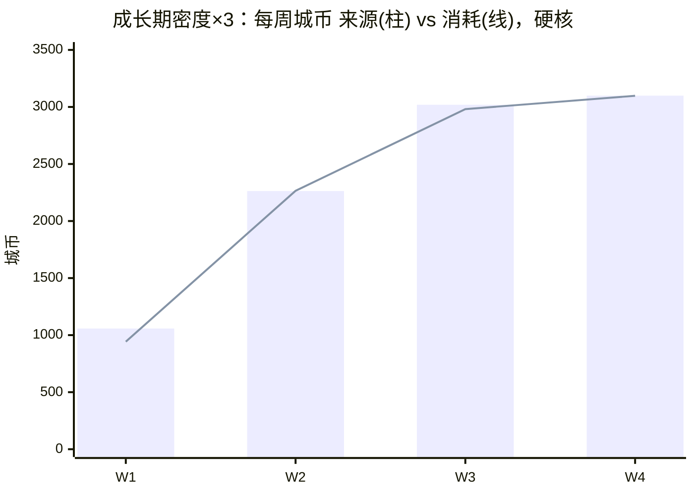

# 城市大富翁 (City Monopoly) + 属性系统 v2：可实施游戏设计规格

- 版本：v1.0，2026-11-14
- 依据：店主 2026-11-14 裁决。城市大富翁是正式玩法，领地并入现有 CITY 棋盘，格子就是漫游·迷雾里的真实地点。占领方式是照片加 GPS 打卡，别人来打卡时，店主获得积分或城币，**不是真钱**。迷雾和棋盘用同一张地图。
- 代码引用：`R=origin/integration/backend-app-r2`，`sys/` = `chengyinhub-system/src/main/java/com/chengyinhub/business/`，`adm/` = `chengyinhub-admin/src/main/java/com/chengyinhub/web/`，`sql/` = `chengyinhub-admin/sql/`，`V/` = `~/Desktop/城瘾vault/`，iOS = `/Users/fanning/orca/workspaces/native-ios/DES-ag4`。
- 只读：本规格没有改动任何仓库。

> **一句话设计**：走路解雾 → 在真实地点拍照加 GPS 圈地 → 别人来这里打卡，你就收租（城币）→ 升级、凑齐同色街区、守住或抢夺地盘 → 28 天一个赛季，赛季结束地盘清零，称号和属性永久保留。

---

## 0. 关键裁决（先读）

| # | 裁决 | 理由 |
|---|---|---|
| D1 | 收租用新货币 **城币 (CityCoin, `CITY_COIN`)**，不用 积分 (`ums_member.point`) | 积分可抵现：`points.deduct.rate_yuan_per_point=0.02`，即 50 积分 = ¥1，每单最多抵 ¥50（`sql/migration_20261023_points_value_config_seed.sql`）。如果玩家之间按别人的打卡发积分，等于转移现金等价物。小号和互刷圈就成了套现通道，也违反了红线「只发 XP/勋章,不发真金券」（`V/03-进行中/App端专属玩法_传感器与AR类_施工方案_20260821.md:17`）。 |
| D2 | 城币只在本赛季有效，**不能购买，不能提现，不能和 积分 或 ¥ 互转**，玩家之间也不能直接转账 | 堵死所有通向真钱的路。审核和合规上，这也不构成「抽奖」或「虚拟货币交易」。 |
| D3 | 骰子只决定**走到哪、抽到哪个任务、挑战成败**。奖励固定，事先通过 quote 公示 | 沿用文档原则「任务随机、奖励确定,避抽奖合规」（`V/03-进行中/具名玩法包…20260820.md` §⑩），以及现有 `city_game_quote` 机制。 |
| D4 | 属性 v2 是**永久的个人六维**（`member_attribute`）。小程序已有的主题内 d20 属性**保持不变**，两者用「印记 (imprint)」映射，印记默认关闭 | 文档写明「生命/幸运属于主题」（`V/04-未开始/城瘾_旅程体验模组化落地规划_20260916.md:194`），不能破坏作者的数值平衡。 |
| D5 | 属性效果**小而有上限**。没有体力等待，没有连签惩罚，属性条不出现在地图屏和扫码屏 | 文档禁止「数值刷子、每日任务、体力等待」（`同上:481,522`），禁止连续天数和断签惩罚（`V/04-未开始/探店日施工审计_5_漫游与导流_20260814.md:72`），并规定「属性条只在「调查」拍出现；地图和扫码屏不得出现属性」（`城瘾_旅程体验模组化…:141`）。 |
| D6 | 这条裁决推翻了旧的「❌ 点亮城市领地 PvP」（`V/06-已废弃/_重复/三模式游玩系统_v3方案_2026-07-03.md:126`；`V/04-未开始/提审后产品积压_20260812/三模式游玩系统_TODO_2026-07-03.md:79`） | 店主 2026-11-14 的新裁决。需要在 vault 里留一份书面裁决记录。 |

---

## 1. 现状（含证据）

### 1.1 CITY 棋盘引擎（已完成：团队骰子棋盘，还不是打卡领地）

| 项 | 现值 | 证据 |
|---|---|---|
| 行动 | `ROLL_ROUND, ACCEPT_TASK, SUBMIT_EVIDENCE, ACQUIRE_PROPERTY, ACCEPT_SERVICE_VISIT, COMPLETE_SERVICE_VISIT, START_CHALLENGE` | `sys/citygame/CityGameRules.java:26-27` |
| 骰子 | 加权表，由服务端用 SecureRandom 掷，最多 200 面，非法表直接拒绝（fail-closed） | `CityGameRules.java:48-99` |
| 移动 | `advance = floorMod(pos+face, trackSize)` | `:102-105` |
| 挑战 | 挑战者点数**严格更大**才赢，平局判守方赢 | `:108` |
| 结算 | `settlementScore = held × holdingYield` | `:111-113` |
| 行动消耗 | `roll_cost/acquisition_cost/task_cost/service_cost/challenge_cost`，默认都是 1 | `sql/migration_20261113_gaps_a_city_game.sql:25-29` |
| 种子棋盘（测试） | `d6 [1..6]` 等权；`actions_per_round=6`；`max_rounds=3`（r491 棋盘是 2）；`acquire_points=30`；`challenge_points=20`；`holding_yield=2`；`goal_score=1`；`holding_limit=3`；`protection_seconds=600`（「占领后十分钟内不可被挑战」）；`quote_valid_seconds=300`；`term_seconds=86400`；队伍 1–4 人；公平性窗口 604800/259200 s；`season_id='s2026w46'` | `scripts/e2e/seed_app_gaps_a.py:24-27`，`seed_app_gaps_a_pass2.py:30-32` |
| 过路费 | `city_game_service.member_points_fee` 10 / 5（单位是**积分**） | `seed_app_gaps_a.py:37-38` |
| 地产状态 | `AVAILABLE/HELD/PROTECTED/PAUSED/SAFETY_BLOCKED`；持有方是 `holder_team_id`，只能是队伍 | 迁移 SQL `:86-91` |
| 地点 ↔ POI | `city_game_point.place_id` 对应 `roam_poi.id`，`merchant_id` 对应 `mms_merchant.id` | `sql/migration_20261114_gaps_a_city_r491.sql:10` |
| 到店证据 | 只认店员核验，**从不用 GPS**：`CHALLENGE_TTL=600`、`EVIDENCE_TTL=7200`、`MAX_CHALLENGES=3`，店员角色限 OWNER/MANAGER/CHECKIN | `sys/citygame/CityArrivalService.java:30-31` |
| 时区 | `Asia/Shanghai` | `CityGameActionService.java:43` |
| 后台 | **没有**。棋盘只能用 SQL 种子创建 | `cloud-systems-audit.md` P1 |
| iOS | 约 30 个 `App/City*View.swift`，加 `CityGameCoordinator`、`CityGamePanel:52 .cyHaptic(.success)` | product-map §2.3 |

### 1.2 漫游·迷雾 与 打卡（会成为收租的触发点）

常量来自 `adm/controller/api/ApiRoamController.java`：
- `DAILY_TILE_XP_LIMIT=200`（1 格 = 1 XP），`TILE_MILESTONES={50,200,1000}`（:61-62）
- `POI_DISCOVER_RADIUS_M=120`、`ROAM_GPS_TOLERANCE_M=30`、`MAX_MOVE_SPEED_MPS=35`、`MIN_MOVE_DIST_M=300`（:156-162）
- `CHECKIN_LOOSE_RADIUS_M=200`、`NODE_MATCH_RADIUS_M=50`、`VISIT_XP=20`（每个点终身一次）（:164-168）
- `SHOP_VISIT_RADIUS_M=100`、`SHOP_VISIT_TELEPORT_WARN_MPS=50`（:263-265）
- 每次会话可点亮的格子上限 `revealTileBudget = 200 + elapsedSec×35/100`（:1018-1030）
- `POST /api/roam/checkin` 现在只接 `name, poiLat, poiLng, curLat, curLng`，**不接精度、轨迹和照片**（:922-970）

其他：
- 迷雾格是 geohash7（约 150 m），唯一键 (member, geohash7)。
- 雾是个人的：「雾是自己的」（`V/02-待部署/漫游四模式_设计裁决与说明_20260909.md:54`）。
- 30 m 自动点亮店铺（同上 :70）。代码里实际是 `REVEAL_M=55`（`…原型逐条搬运_进度_20260909.md:100`）。
- 服务端**不校验** geohash7 的真实性，所以它「不能承载奖励资格」（`V/03-进行中/官方活动P0_任务绑定证据与活动360合同_20260722.md:67,96`）。因此占领需要独立的证据链（§2.2）。
- iOS 揭雾目前只读：`Core/PersonalFogLedger.swift` 里 `revealSyncEnabled=false`、`liveRevealEnabled=false`。

### 1.3 现有属性系统（小程序：主题内 d20 属性）

注册在 `sys/service/support/ThemeAttributeService.java:56-67`：每个主题最多 6 个属性，取值 0–20，存于 `theme_state_key.is_attribute=1`（`sql/migration_20261028_d20_attribute_registry.sql`），键名 `counter.<name>`，**每局重置**。

| preset | 中文 | 区间 | 初值 | 显示 |
|---|---|---|---|---|
| observe | 观察 | 0–5 | 2 | 星 |
| nerve | 胆量 | 0–10 | 6 | 条 |
| body | 体魄 | 0–8 | 4 | 条 |
| insight | 灵感 | 0–5 | 1 | 数字 |
| agility | 敏捷 | 0–5 | 2 | 数字 |
| charm | 魅力 | 0–5 | 2 | 星 |
| fortune | 运气 | 0–3 | 1 | 星 |
| custom | 作者自定 | 0–5 | 0 | 数字 |

主题生命值（`JourneyRules.java:133-200`）：
- 生命/精力 10/10，幸运 3/3（花 1 点可重掷）。
- DC 和失败伤害：易 10/1，中 13/2，难 16/3。
- `modCap=6`，`natAuto=true`，`fumbleExtraDamage=1`。

检定公式：`d20(+优势/劣势) + 属性 + min(Σ修正, modCap)`（`GameplayCheckEngine.java:60-95`）。

难度预设（`JourneyDifficulty.java:20-22`）：EASY 8/11/14，STANDARD 10/13/16，HARD 12/15/18。

小程序显示位置：
- `pages/play/index.js:167-174`（开局状态行）
- `pages/play/components/playkit-journey-check/index.wxml:58,80-83`（检定拆解）

主题角色保留键 `sys.xp / sys.level / sys.skill_points`（iOS `Core/OriginalRpgGrowthFacts.swift:5`）。

**全仓库都没有**永久六维、雷达图、职业、金币或体力。能量和城市分已退役（`sql/migration_p3_phase_b_retire_energy.sql`）。

### 1.4 现有经济

| 池 | 存储 | 规则 / 值 | 证据 |
|---|---|---|---|
| 探索值 XP | `member_growth.exp_value/level_no`；流水 `member_exp_earned` | `level_no = greatest(level_no, floor(exp/100)+1)`：线性，每 100 XP 升 1 级，永不降级 | `MemberGrowthMapper.xml:35` |
| XP 来源 | 主题预算 3000（节点分 60%，按权重拍照/答题 3、扫码 2、GPS 1）；节点保底 12；格子 1 XP（每日 200 上限）；POI 20；随机掉落 15%（`reward.drop.base.prob.bp=1500`） | `XpBudgetServiceImpl.java:25`，`PlayNodeCompletionApplication.java:452`，v3方案:50-54 |
| 两池铁律 | 「XP 只入 member_growth…**绝不写** ums_member_points_detail…两池永不互转」 | `V/06-已废弃/_重复/三模式游玩系统_v3方案:48` |
| 积分 | `ums_member.point` + `ums_member_points_detail`，唯一键 (member, event_type, event_id)。规则：注册 50、邀请首单 500、到店核销 5、节点打卡 10、通关 50；消耗：提示 10 | `cms_points_setting` 与各迁移 |
| 积分价值 | 0.02 元/积分，每单最多抵 ¥50 | 见 D1 |
| 第二成长表 | `player_growth(total_checkins, streak_days, total_mileage, level=checkins/5+1)` | `PlayerProgressionServiceImpl.java:115-145` |
| 徽章 | `growth_badge` / `player_badge`；种子 FIRST_STEP、TOPIC_CLEAR、MILE_10/50、STREAK_3/7；`ROAM_TILES_{50,200,1000}`；节点金银铜 | `sql/migration_p4_badge_def_engine.sql:27-32` |
| 通行证 | **付费会员**（月卡 ¥39 / 年卡 ¥299，目前未上架），不是战令 | `sql/migration_20261110_platform_pass.sql:91-92` |
| 赛季 | 只有 CITY 有 `season_id`。文档写「赛季长线(2~6周)」，「先只做单赛季、无榜」 | `V/05-参考资料/Questify官方活动系统_产品设计报告_2026-07-08.md:107`；模组化规划:546 |
| 排行榜 | 积分榜和 XP 榜，周榜和总榜；俱乐部榜按贡献排；「前 10 + 自己前后各 2 名」 | `GrowthServiceImpl.java:96-176`；俱乐部视觉重做:105 |
| 队伍/俱乐部 | `club_leader.level` 0–5 由人工设置；`play_team` 只有状态；**没有队伍或俱乐部积分账** | `pages/club/detail/index.js:288` |
| iOS 成长 | `GrowthCenterContracts.swift`：`levelNo, expValue, points, badges, missions`；`level, totalCheckins, totalMileage, streakDays`；榜单 `point/exp × week/total` | iOS `Core/GrowthCenter*.swift` |

---

## 2. 城市大富翁规则

### 2.1 棋盘模型

| 概念 | 定义 | 数值 |
|---|---|---|
| 棋盘 Board | 一个城市区域在一个赛季里的 `city_game_board`（`mode=LIVE`） | 每城 1 张 LIVE 板，再加每周 1 场 `DICE_EVENT` 城市局（§2.9） |
| 格子 Property | `city_game_property` → `city_game_point.place_id` → `roam_poi`。**就是迷雾地图上的真实店铺或地标** | 开城时每板 40–80 个。可占领的 OPERABLE ≥ 80%，NEUTRAL（公园、广场 = 机会格）10–20% |
| 街区 District = 色组 | 后台画的商圈多边形（没画就用行政区）。每个街区 4–10 格 | 每板 6–10 个街区 |
| 色组颜色 | 设计系统令牌 `district.c1…c10`。**紫色不用于街区**，只留给 T4 地标的稀有光晕（设计方向是「purple only rare」） | — |
| 迷雾联动 | 同一张地图。你**没点亮过的格子**里的地产只显示街区色剪影和「?」，持有人隐藏；点亮后显示持有人、等级、保护倒计时 | 用 geohash7 关联：`city_game_point.geohash7` |

**格子等级（Tier）**：沿用商家节点 L1–L4（普通/优质/精选/官方合作，`V/05-参考资料/Questify_点亮城市商家节点系统_PRD.md:963-990`）。

| Tier | 名称 | 典型地点 | 占领价 | 每次到访基础租 `base` | 期望有效到访（开城 / 成长期，每格每天） |
|---|---|---|---|---|---|
| T1 | 街角 | 普通 POI、小店 L1 | 60 | 3 | 0.6 / 1.8 |
| T2 | 小店 | 商家 L2 | 120 | 5 | 1.2 / 3.6 |
| T3 | 名店 | 商家 L3 / 次级地标 | 240 | 8 | 2.4 / 7.2 |
| T4 | 地标 | L4 官方合作 / 城市地标 | 400 | 12 | 4.0 / 12 |

**商家格**必须先通过现有的 `city_merchant_operation` 拿到商家同意才能上板。商家员工（`MERCHANT_OWNER/MANAGER/CHECKIN`）**不能占领自家门店，也不能在自家门店给别人产生租金**。

### 2.2 占领（Claim）要求

| 检查 | 阈值 | 说明 |
|---|---|---|
| 距离 | 服务端用 Haversine 算设备到格子锚点 ≤ **40 m** | 比打卡的 50 m 更严 |
| 精度 | iOS `horizontalAccuracy` ≤ **25 m** | 商家格允许改用**店内静态码**（C1「进店事实只认扫店内静态码」），扫码时精度放宽到 ≤ 65 m |
| 驻留轨迹 | 提交前 60–300 s 内至少有 **3 个**定位样本，时间跨度 ≥ **60 s**，全部在锚点 80 m 内 | 防止瞬移打卡 |
| 速度 | 相邻样本速度 ≤ **35 m/s**（`MAX_MOVE_SPEED_MPS`）；> **50 m/s** 写入 teleport 审计 | 复用现有常量 |
| 模拟定位 | `CLLocation.sourceInformation.isSimulatedBySoftware == true` → 拒绝并记 1 次 spoof 标记 | 仅 App |
| 设备证明 | 占领和挑战请求必须带 **App Attest** assertion | 仅 App；小程序**不能占领**（CITY 在小程序里本来就不做），但小程序玩家可以作为访客产生租金 |
| 照片来源 | 只能用 App 内相机拍摄，不能从相册选。拍摄时间距提交 ≤ **120 s** | 不依赖 EXIF：文档说「EXIF 可以被伪造…别写成杜绝作弊」，小程序也会剥掉 EXIF |
| 照片元数据 | App 在拍摄瞬间签名 `{lat,lng,hAcc,capturedAt,assetSha256}`，服务端比对证据位置和请求位置的差 ≤ 30 m | — |
| 重复照片 | 64-bit pHash：和**自己**在该格的旧照片汉明距离 ≤ **8** 判为复用，拒绝；和**他人**在该格的照片 ≤ **4** 判为盗图，拒绝 | — |
| 内容 | 走现有 `submissionSafety` 机审；翻拍屏幕或摩尔纹分数 ≥ 0.7 → 拒绝 | 随机抽 **5%** 人审，`risk_score ≥ 0.6` 全部人审 |
| 迷雾前置 | 该格子的 geohash7 必须已被你点亮，或在本次提交里点亮 | 叙事前置条件，不当作安全依据 |
| 账号门槛 | 注册 ≥ **3 天**，账号等级 ≥ **Lv3**（`member_growth`），已绑手机，已同意位置协议 | — |
| 时段 | **06:00–23:00**（Asia/Shanghai）可占领。天气红色预警时该区域进入 `SAFETY_BLOCKED` | 安全 |
| 冷却 | 每天最多 **3 次**新占领；同一格每天最多失败 **3 次**；丢失某格后 **24 h** 内不能再占领它 | — |
| 持有上限 | 个人 **9 格**，探索属性 Lv15/30/45 各 +1，最多 **12 格** | 现有 `holding_limit` 的语义从「每队」改为「每人」 |

占领流程沿用 r491 的 quote → confirm 模式：
1. `quote` 返回 `{cost, protectionUntil, rulesHash}`，有效 300 s。
2. `command` 带 `requestId`（大写 UUID）、`quoteHash` 和证据。
3. 服务端裁决，写回执和事件。

### 2.3 等级与升级

| 级 | 名 | 升级费（占领价的倍数） | T1 / T2 / T3 / T4 升级费 | 租金倍率 `U` | 挑战 DC 加成 |
|---|---|---|---|---|---|
| Lv0 | 插旗 | — | 占领价 60 / 120 / 240 / 400 | 1.0 | +0 |
| Lv1 | 前哨 | ×0.5 | 30 / 60 / 120 / 200 | 1.4 | +2 |
| Lv2 | 据点 | ×0.8 | 48 / 96 / 192 / 320 | 1.8 | +4 |
| Lv3 | 地标旗 | ×1.2 | 72 / 144 / 288 / 480 | 2.4 | +6 |
| 累计投入 `invested`（满级） | | | 210 / 420 / 840 / 1400 | | |

- 升级必须**本人到场**（同 §2.2 的 GPS 规则，可不拍照），每格每天最多升 1 级，每人每天最多升 2 次。
- 升级给 +10 XP，以及城识 +5 AXP。

### 2.4 收租（别人打卡 → 你收城币）

**触发**：访客 V 用 `POST /api/roam/checkin`（或 `/api/play/arrive`）在 HELD 格锚点 **≤ 50 m**（`NODE_MATCH_RADIUS_M`）打卡，精度 ≤ 35 m，并通过 §2.11 的资格检查，就产生一条 `city_yield_event`。

**公式**：

```
yield = round( base[tier] × min(M_CAP, U[lvl] × S_set × T_time × W_env × B_team × (1 + 0.002 × charmLvl_owner)) )
M_CAP = 4.0
```

| 乘数 | 取值 |
|---|---|
| `U` 等级 | 1.0 / 1.4 / 1.8 / 2.4 |
| `S_set` 街区色组 | 持有人占该街区可占领格 < 50%：1.0；≥ 50%（多数）：**1.2**；100%（垄断）：**1.5** |
| `T_time` 时段 | 06–10 晨探 **1.1**；10–17 **1.0**；17–21 黄金 **1.2**；21–23 **1.0**；23–06 **0**（不产租，打卡仍然点雾、发 XP） |
| `W_env` 天气/活动 | 小到中雨 **1.2**（需要真实天气源。TEST 环境固定晴，`tencent.map.enabled=false`）；后台「双倍收租日」最高 **2.0**；暴雨、台风、高温红色预警 → `SAFETY_BLOCKED`，乘数为 0 |
| `B_team` 战队 | 持有人所在战队（2–6 人）在该街区合计持有 ≥ 3 格：**1.1**，否则 1.0 |
| 魅力 | 持有人魅力每级 +0.2%，Lv50 时 +10% |

**到访者也有奖励**：每次产生租金的打卡，访客得 **+2 城币**（每天最多 10 次，即 20 城币），另得城识 +3 AXP。访客**不付钱**。这样鼓励玩家去商家店里，而不是让人绕开。

**单次租金速查**（`T_time=1`，不含色组）：

| Tier | Lv0 | Lv1 | Lv2 | Lv3 | 乘数封顶 4.0 时 |
|---|---|---|---|---|---|
| T1 | 3 | 4 | 5 | 7 | 12 |
| T2 | 5 | 7 | 9 | 12 | 20 |
| T3 | 8 | 11 | 14 | 19 | 32 |
| T4 | 12 | 17 | 22 | 29 | 48 |

**入账**：租金实时写入 `pending`（App 立刻显示「收租」反馈）。每天 **03:00** 风控批处理通过后转为 `available`，可以花；被判作弊的直接作废（`CLAWBACK`）。

### 2.5 每日上限

| 维度 | 上限 |
|---|---|
| 持有人每日租金 | 阈值 `T = 200 + min(100, 2×魅力Lv)`。前 T 按 100% 入账，超出部分按 **50%** 入账，单日最多 **T + 100**（即 300–400 城币） |
| 单格每日有效到访 | **20** 次 |
| 访客 → 同一格 | **1 次/天** |
| 访客 → 同一持有人（配对上限） | 同一格 **1 次/7 天**；该持有人的所有格合计 **3 次/7 天** |
| 访客每日能产生租金的打卡 | **10** 次 |
| 机会格任务 | **2 次/天**，每次固定 **15** 城币 |
| 新占领 / 升级 / 发起挑战 | 3 / 2 / 3 次每天 |
| 单格每天被挑战次数 | **3** |

### 2.6 保护期

| 事件 | 保护 |
|---|---|
| 新占领 | **24 h**（种子棋盘是 600 s，那只是测试值） |
| 防守成功 | **12 h** |
| 抢夺成功（新主人） | **24 h** |
| 「护盾」道具 | +12 h，花 **60** 城币，同一格 7 天内只能用 1 次，不能叠加到 48 h 以上 |
| 决战周（第 22–28 天） | 新占领保护缩短为 **12 h** |

### 2.7 挑战与抢夺

挑战者必须**在场**，GPS 规则同 §2.2，但不用拍照。同一时间每格只能有一个挑战在进行（沿用 `challenge_state`）。

1. **报价**：挑战费 = `max(30, 0.5 × invested)` 城币。例如 T1 Lv0 是 30，T2 Lv1 是 90，T4 Lv3 是 700。
2. **在地任务**：服务端从该格的任务池随机选 1 个（答题或拍照，复用 `city_task_definition`）。
   - 失败：挑战立即结束，费用退 50%。
   - 通过：修正 +1。
   - 一次就满分：修正 +2。
3. **服务端 d20**：`d20 + mod ≥ DC` 即赢；**掷出 20 必赢，掷出 1 必输**（和主题的 `natAuto` 一致）。
   - `DC = 10 + 2×lvl + 2×[持有人或其战队 72 h 内到访过] + {多数 +1, 垄断 +2} − 2×[风化]`，上限 20。
   - `mod = 任务(0–2) + 洞察加成(Lv15 +1 / Lv35 +2) + 同队在场助攻（100 m 内，每人 +1，最多 +2）`，`mod` 上限 **6**（= 现有 `modCap`）。
4. **结果**：
   - **挑战者赢**：地产转手，等级降 1（不低于 0），新主人 `invested` 按降级后的等级重算。原主人拿到费用的 **40%** 作为补偿，其余 60% 销毁。
   - **挑战者输**：原主人拿到费用的 **30%**，其余 70% 销毁。地产获得 12 h 保护。挑战者对该格冷却 24 h。
5. 守方不用在线，结果推送通知。平局不存在，因为 `≥` 判定已经包含了 `CityGameRules.challengerWins` 的「平局守方赢」语义：DC 本身就是守方优势。

**胜率表**（%）：

| DC \ mod | +0 | +1 | +2 | +3 | +4 | +5 | +6 |
|---|---|---|---|---|---|---|---|
| 10 | 55 | 60 | 65 | 70 | 75 | 80 | 85 |
| 12 | 45 | 50 | 55 | 60 | 65 | 70 | 75 |
| 14 | 35 | 40 | 45 | 50 | 55 | 60 | 65 |
| 16 | 25 | 30 | 35 | 40 | 45 | 50 | 55 |
| 18 | 15 | 20 | 25 | 30 | 35 | 40 | 45 |
| 20 | 5 | 10 | 15 | 20 | 25 | 30 | 35 |

所以有人经常去、升满级的垄断地标（DC 20）只能靠运气和团队去打（最多 35%）。放任不管、已经风化的 Lv0 街角（DC 8）遇到 mod +3 的挑战者，大约 80% 会被抢走（d20 ≥ 5）。

### 2.8 衰减（持有人不来）

按 `last_owner_visit_at` 计算。战队持有时，任一成员到访都算。持有人自己在自己的格打卡**不产租**，但会刷新到访时间。

| 距上次到访 | 状态 | 效果 |
|---|---|---|
| 0–7 天 | 正常 | — |
| 7–13 天 | **风化** | 租金 ×0.5，DC −2，地图上旗帜褪色 |
| 第 14 天 | 失修 | 等级 −1，之后每 3 天再 −1 |
| 第 21 天 | **释放** | 变回 `AVAILABLE`，`invested` 不退 |
| 提醒 | 第 5、12、19 天推送 | 仅提醒，没有惩罚性文案（遵守「断签惩罚」禁令） |

城识 Lv20 时所有阈值 +1 天，Lv40 时 +2 天。

### 2.9 骰子（现实版里什么时候掷）

| 场景 | 骰 | 面与权重 | 修正 |
|---|---|---|---|
| A. 挑战判定 | d20 | 1–20 等权 | 见 §2.7。运气属性**不改概率**，只给重掷次数 |
| B. 机会格（NEUTRAL） | d6 → 任务表 | 1–2 拍照任务，3–4 城市知识题，5 寻物，6 自选 | **奖励固定 15 城币**，骰子只决定任务类型（合规） |
| C. 每周城市局（`DICE_EVENT`，周六 14:00–18:00，复用 `ROLL_ROUND`） | 加权 d6 | faces `[1,2,3,4,5,6]`，weights `[3,3,3,2,2,1]`，期望 3.0 站 | 轨道是 12–20 格，相邻格步行 150–400 m，所以一次掷骰最多走约 2.4 km。体魄 Lv30：每轮可以「多走一站」1 次 |
| 重掷 | — | 运气 Lv10：每天 1 次；Lv25：每天 2 次。只适用于 A 和 C，并且**必须在看到对手 DC 之前**决定 | 重掷记录写入 `city_game_roll.result_json`（审计） |

城市局参数（替换种子值）：

| 参数 | 值 |
|---|---|
| 掷骰 | `actions_per_round=6`，`max_rounds=4`（每小时 1 轮） |
| 队伍 | 2–4 人（`min_members` 从 1 改为 2） |
| 积分与费用 | `holding_yield=2`，`goal_score=1` |
| 过路费 | 落在他队地产上付 **10 城币**，直接转给对方队长账户，零和 |
| 奖励 | 前三名队伍每人得 **+150 XP** 和活动徽章；全员 +50 XP |
| 计入赛季 | 城市局积分 ×5 计入赛季团队分 |

### 2.10 赛季

| 项 | 值 |
|---|---|
| 长度 | **28 天**（文档范围 2–6 周），周一 10:00 开，第 4 周周日 22:00 冻结（`lifecycle=FROZEN`）。周一 10:00 开新赛季，中间有 12 h 休赛结算 |
| ID | `s{YYYY}w{ISO周}`，与现有 `s2026w46` 一致 |
| 阶段 | 第 1–3 天「开城」：每人送 **300 城币**启动金。第 4–21 天常规。第 22–28 天「决战周」：挑战费 −25%，新占领保护 12 h |
| 重置 | 所有地产回到 `AVAILABLE`，等级和 `invested` 清零。城币 `carry = min(300, floor(0.2 × balance))`，其余销毁。**属性、XP、称号、徽章永不重置** |
| 个人赛季分 SS | `SS = Σ已确认租金 + 20×首占格数 + 30×抢夺成功 + 10×防守成功 + Σ_日 Σ_格 w[tier]`，其中 `w = 1 / 1.5 / 2 / 3`（持有天数项） |
| 战队分 | 成员 SS 最高的 4 人之和，加城市局积分 ×5 |
| 俱乐部分 | 成员 SS 最高的 20 人之和，加 50 × 有成员持地的街区数 |
| 城市版图 | 实时街区控制图，不排名 |
| 排行显示 | 前 10 名，加自己前后各 2 名（沿用俱乐部榜的规范） |

**赛季奖励**：不发城币、积分或现金。

| 档 | 奖励 |
|---|---|
| 个人第 1 名 | 限定称号「城主·{城市}·S{n}」，限定 3D 徽章，+3000 XP |
| 个人前 10 名 | 「名门地主」徽章，+1500 XP |
| 前 1% | +2000 XP 和赛季金徽章 |
| 前 10% | +800 XP 和银徽章 |
| 前 50% | +300 XP |
| 参与者（≥ 1 次占领） | 「开拓者 S{n}」徽章，+200 XP |
| 战队前 3 | 战队徽章 |
| 俱乐部前 3 | 俱乐部徽章（`growth_badge.club_id`）和俱乐部称号「城市名门」 |

限定奖励「过期不补」（官方活动报告:69,254）。

### 2.11 防作弊

| 类型 | 规则 | 阈值 |
|---|---|---|
| 自刷 | 持有人本人、同战队成员、该商家员工打卡**不产租**。持有人本人打卡只刷新到访时间 | — |
| 小号：访客资格 | 注册 ≥ **7 天**；账号 ≥ **Lv3**；已绑手机；最近 14 天在 **≥ 2 个不同持有人**的格子有过打卡，或在非棋盘 POI 有过 ≥ 3 次打卡 | 不满足时打卡照常点雾，但不产租 |
| 小号：设备 | 每台设备（IDFV + DeviceCheck 2-bit；小程序用 unionid）30 天内只有 **1 个**账号能产租。同设备 ≥ **3 个**账号 → 全部冻结租金并人审 | — |
| 互刷：配对 | 配对上限见 §2.5 | 每格 1 次/7 天，合计 3 次/7 天 |
| 互刷：互惠 | 14 天内 A→B 产租 ≥ 3 次**并且** B→A ≥ 3 次 → 双方这对互访权重归 0，持续 14 天 | — |
| 互刷：集中度 | 持有人 7 天租金 > 300，且前 3 名访客贡献 > **60%**（或 HHI > 0.35）→ 下 7 天租金 ×0.5，并进人审队列 | — |
| 互刷：环 | 每周跑一次产租图社区检测：某社区内部产租占其成员总租金 ≥ **80%** 且成员 ≥ 4 → 整个社区挂起 | — |
| 定位造假 | 见 §2.2。30 天内 spoof 标记 ≥ **3 次** → CITY 封禁 7 天；再犯 → 本赛季封禁，赛季分清零 | — |
| 回收 | 当前赛季内作弊所得租金 `CLAWBACK`；余额不够扣时记负数，后续收入先补 | — |
| 透明 | 每条租金都能在收租明细里看到访客（脱敏）、乘数和上限原因 | 方便申诉 |

### 2.12 经济平衡与 28 天模拟

**模型**：脚本 `scratchpad/cm/sim.py`，蒙特卡洛 400 次，用期望值。规则：
- 到访按 Poisson(λ[tier] × 密度) 生成；时段按 15/45/30/10% 分布；下雨概率 20%；第 27 天是活动日 ×1.5。
- 每格每天被他人挑战的概率：T1 1%、T2 2%、T3 4%、T4 6%，胜率按 §2.7 的 DC 算。
- 维护费 2%/天 × `invested`。
- 消费行为：先占领，再升级，有余额后挑战。余额超过阈值时，部分花在外观上（休闲 600×30%、常规 500×30%、硬核 700×50%）。

**玩家画像**：

| 画像 | 活跃 | 每天打卡 | 机会格 | 目标持有 | 挑战 |
|---|---|---|---|---|---|
| 休闲 casual | 每周 2 天 | 4 | 1 | 2 格（T1、T2） | 0 |
| 常规 regular | 每周 4 天 | 8 | 2 | 6 格 | 每周 1 次 |
| 硬核 hardcore | 每天 | 10 | 2 | 12 格（偏 T3、T4） | 第 5 天起每天 1 次 |

**结果：每人每天平均 城币**（来源 / 消耗）：

| 画像 | 开城密度 ×1：来源 | 消耗 | 消耗/来源 | 期末余额（均值，P95） | 成长期密度 ×3：来源 | 消耗 | 消耗/来源 | 期末余额（均值，P95） |
|---|---|---|---|---|---|---|---|---|
| 休闲 | 31.4 | 26.6 | 0.85 | 132（236） | 71.2 | 39.4 | 0.55 | 889（1074） |
| 常规 | 65.0 | 57.9 | 0.89 | 198（319） | 214.5 | 171.8 | 0.80 | 1195（1558） |
| 硬核 | 157.4 | 152.9 | 0.97 | 128（237） | 337.1 | 331.7 | 0.98 | 150（238） |

**28 天来源构成**（开城密度）：

| 画像 | 启动金 | 租金 | 访客奖励 | 机会格 | 补偿 | 合计 | 占领 | 升级 | 维护费 | 挑战 | 外观 | 合计 |
|---|---|---|---|---|---|---|---|---|---|---|---|---|
| 休闲 | 300 | 370 | 64 | 120 | 25 | 879 | 198 | 378 | 170 | 0 | 0 | 746 |
| 常规 | 300 | 737 | 256 | 480 | 46 | 1819 | 480 | 795 | 321 | 25 | 0 | 1621 |
| 硬核 | 300 | 2514 | 560 | 840 | 194 | 4408 | 1080 | 1333 | 632 | 1236 | 0 | 4280 |

**周度来源与消耗**（S = source 来源，K = sink 消耗；█ = 来源，░ = 消耗，每格 100 城币）：

```
密度×1  硬核  W1 S 756 ███████▌   K 599 ██████
             W2 S 728 ███████▎   K 759 ███████▌
             W3 S1106 ███████████ K1089 ███████████
             W4 S1819 ██████████████████ K1833 ██████████████████▎
        常规  W1 S 571 █████▋     K 448 ████▌
             W2 S 345 ███▍       K 337 ███▍
             W3 S 400 ████       K 364 ███▋
             W4 S 503 █████      K 472 ████▋
密度×3  硬核  W1 S1058 ██████████▌ K 943 █████████▍
             W2 S2263 ██████████████████████▋ K2265 ██████████████████████▋
             W3 S3019 ██████████████████████████████▏ K2981 █████████████████████████████▊
             W4 S3099 ██████████████████████████████▉ K3098 ██████████████████████████████▉
        休闲  W1 S 544 █████▍     K 411 ████
             W2 S 413 ████▏      K 290 ██▉
             W3 S 492 ████▉      K 130 █▎
             W4 S 544 █████▍     K 273 ██▋
```



**通胀有界的证明**（公式）：

1. 单人单日来源有硬上限：`S_day ≤ (T+100) + 20 + 30 + C_comp`。其中 `T+100 ≤ 400`。`C_comp ≤ 0.4 × Σ被挑战费`，而每格每天最多被挑战 3 次，持有最多 12 格。实际取 `S_day ≲ 450`。
2. 单赛季单人货币总量：`M ≤ 300 启动金 + 300 结转 + 28 × 450 ≈ 13,200`。
3. 跨赛季：`M_start(n+1) ≤ 300 + min(300, 0.2 × M_end(n)) ≤ 600`，**与 n 无关**，所以长期不通胀。
4. 赛季内价格固定（配置冻结进 `rules_hash`）。后台每赛季调价幅度 ≤ ±20%。
5. 维护费 `0.02 × invested` 随持有量线性增长，是对大户的累进消耗。挑战费有 60–70% 被销毁。
6. 监控 KPI（后台告警）：
   - 中位余额 / T2 占领价 > **5**，说明需要加消耗。
   - 全服 消耗/来源 < **0.6** 连续 7 天 → 开活动商店或调低启动金。
   - 硬核 P95 余额 > **1500**。
7. 成长期休闲玩家会攒钱（消耗/来源 0.55），这是有意为之：他们可以买外观，赛季末最多结转 300，影响有界。

**回本速度**（单格，`T_time=1`，扣除维护费）：
- T2 Lv0 每天净收入约 4 城币（开城）或约 16 城币（成长期），回本约 30 天或 8 天。
- 开城期回本慢于赛季长度，所以提供后台参数 `env.city_launch_multiplier`，前两个赛季建议设 **1.5–2.0**。

---

## 3. 属性系统 v2：城瘾六维

### 3.1 六维定义与旧属性映射

| key | 中文 | English | 类比 | 小程序主题属性印记映射 |
|---|---|---|---|---|
| `explore` | 探索 | Exploration | 新地方 | `nerve` 胆量（敢走陌生路） |
| `stamina` | 体魄 | Stamina | 走得远、走得久（**不是体力槽**） | `body` 体魄、`agility` 敏捷 |
| `insight` | 洞察 | Insight | 答对、看懂 | `observe` 观察、`insight` 灵感 |
| `charm` | 魅力 | Charisma | 和人一起玩 | `charm` 魅力 |
| `luck` | 运气 | Luck | 慢慢涨、不可刷 | `fortune` 运气，以及主题生命值里的「幸运」 |
| `lore` | 城识 | Street-smarts | 懂这座城 | `custom`（不映射） |

**其他现有字段的去向**：
- `member_growth.level_no/exp_value`（账号等级/探索值）：**保持原样**。小程序的 `level-progress` 组件不受影响，六维是另一层。
- `totalMileage` 计入体魄来源；`totalCheckins` 计入探索和城识来源。
- `streak_days` **不**进任何属性，因为禁止连签压力。
- 主题生命值（生命 10/10，幸运 3/3）和 `sys.xp/level/skill_points` 不变。

**印记（imprint）**：主题配置 `personaImprint=true` 时生效，**默认关闭**。开局时映射到的主题属性初值：六维 Lv ≥ 20 时 +1，≥ 40 时 +2，再夹到 preset 上限内。例如 `fortune` 最大 3，`observe` 最大 5。

### 3.2 获取：AXP 来源（全部来自服务端可信事实）

| 属性 | 来源事件 → AXP | 每日软上限 S |
|---|---|---|
| 探索 | 新雾格 +1（和 XP 共用 200 格的限制）；首次点亮 POI +10；本赛季首次进入新街区 +30；单次漫游 ≥ 2 km +10 | 200 |
| 体魄 | 服务端校验过的漫游里程每 km +10（`roam_session` 里程，受 35 m/s 限制）；可选 HealthKit 步数，每 1000 步 +1，每天最多 +20，需单独授权；单次会话 ≥ 30 min +10 | 150 |
| 洞察 | 题目首次答对 +5，再乘近 20 题正确率系数（< 50%：×0.5，50–80%：×1.0，> 80%：×1.2）；解谜 100 分（不用提示）+10；d20 检定在 DC ≥ 13 时成功 +5；拍照任务人审通过 +5；挑战里的任务满分 +10 | 150 |
| 魅力 | 和 ≥ 2 人组局完成 +10；俱乐部活动核验到场 +20；邮票交换 +5；照片被他人点赞每次 +1（每天最多 10）；邀请的新人到 Lv3 +30 | 120 |
| 运气 | 掷出 20 点 +5；获得随机掉落 +5；完成机会格任务 +3；任一活跃日 +2 | 40（硬顶 Lv30，见下） |
| 城识 | 本赛季在某街区打卡满 3 次 +20（每街区 1 次）；打卡到 30 天内没去过的品类 +5；官方城市知识题答对 +5；本赛季首个占领某格 +10；作为访客给别人产租 +3；持有人维护到访 +2；升级 +5 | 150 |

**递减**：

```
AXP_eff(当日) = min(x, S) + 0.25 × min(max(x − S, 0), S)
```

单日硬顶 = 1.25 S。

运气 **Lv30 封顶**。超过 Lv30 的 AXP 只计入「锦鲤」展示进度，没有任何效果。

### 3.3 等级曲线（每个属性独立，Lv1–50）

```
need(L) = round5( 12 × L^1.25 × 1.075^max(0, L−25) )   // 从 L 升到 L+1 需要的 AXP
cum(L)  = Σ_{k<L} need(k)
```

| Lv | 升下一级 | 累计 | Lv | 升下一级 | 累计 |
|---|---|---|---|---|---|
| 1 | 10 | 0 | 2 | 30 | 10 |
| 3 | 45 | 40 | 4 | 70 | 85 |
| 5 | 90 | 155 | 6 | 115 | 245 |
| 7 | 135 | 360 | 8 | 160 | 495 |
| 9 | 185 | 655 | 10 | 215 | 840 |
| 11 | 240 | 1055 | 12 | 270 | 1295 |
| 13 | 295 | 1565 | 14 | 325 | 1860 |
| 15 | 355 | 2185 | 16 | 385 | 2540 |
| 17 | 415 | 2925 | 18 | 445 | 3340 |
| 19 | 475 | 3785 | 20 | 510 | 4260 |
| 21 | 540 | 4770 | 22 | 570 | 5310 |
| 23 | 605 | 5880 | 24 | 635 | 6485 |
| 25 | 670 | 7120 | 26 | 755 | 7790 |
| 27 | 855 | 8545 | 28 | 960 | 9400 |
| 29 | 1080 | 10360 | 30 | 1210 | 11440 |
| 31 | 1355 | 12650 | 32 | 1515 | 14005 |
| 33 | 1695 | 15520 | 34 | 1890 | 17215 |
| 35 | 2105 | 19105 | 36 | 2345 | 21210 |
| 37 | 2610 | 23555 | 38 | 2900 | 26165 |
| 39 | 3220 | 29065 | 40 | 3570 | 32285 |
| 41 | 3960 | 35855 | 42 | 4385 | 39815 |
| 43 | 4855 | 44200 | 44 | 5375 | 49055 |
| 45 | 5940 | 54430 | 46 | 6565 | 60370 |
| 47 | 7250 | 66935 | 48 | 8000 | 74185 |
| 49 | 8825 | 82185 | 50 | — | 91010 |

**节奏**（主属性每天有效 AXP 30 / 110 / 250）：

| 画像 | 1 个赛季 | 3 个月 | 6 个月 | 1 年 |
|---|---|---|---|---|
| 休闲 | Lv10 | 15 | 21 | 29 |
| 常规 | Lv17 | 27 | 34 | 42 |
| 硬核 | Lv24 | 35 | 42 | 50 |

Lv25 之后曲线变陡（每级多 7.5%），Lv50 是一年的目标。

**回填**：上线时按历史回填，每个属性最多回填到 **Lv15**（2185 AXP），避免老玩家一上线就碾压。
- 探索 = 格子数 × 1 + POI × 10
- 体魄 = 里程 km × 10
- 洞察 = 通关节点中的答题数 × 5，最多回填到 Lv10
- 魅力 = 俱乐部活动 × 20，最多回填到 Lv10
- 城识 = 去过的品类数 × 5
- 运气 = 0

### 3.4 各模式效果（小、有上限、全部服务端执行）

| 属性 | CITY 大富翁 | 漫游·迷雾 | 答题/节点玩法 | 骰子 |
|---|---|---|---|---|
| 探索 | 持有上限 9 → +1 @15/30/45（最多 12） | Lv30：地图提示 140 m 内未发现的 POI 剪影（只是展示，**不改**服务端 120 m 的发现半径） | — | Lv25：机会格每天可换 1 次任务类型 |
| 体魄 | 挑战前 60 min 内服务端里程 ≥ 1 km：「热身」+1 修正（Lv20 起） | 赛季体魄徽章；Live Activity 显示里程 | 印记：body/agility | Lv30：城市局每轮「多走一站」1 次 |
| 洞察 | 挑战修正 +1 @15、+2 @35 | — | Lv20：每天 1 次免费提示（替代 10 积分）；印记 observe/insight | — |
| 魅力 | 租金 +0.2%/级（≤ +10%）；每日阈值 +2/级（≤ +100）；Lv30：同队助攻上限 +1（mod 总上限仍是 6） | 附近跑者卡片显示称号 | 印记 charm | — |
| 运气 | — | 掉落率**不变**（合规），只解锁收藏外观 | 印记 fortune（主题幸运 +1，不超过 3） | 重掷：Lv10 每天 1 次，Lv25 每天 2 次 |
| 城识 | 衰减宽限 +1 天 @20、+2 天 @40；维护费 −5% @25、−10% @45；Lv10 免费「侦察」（看 DC，否则 10 城币） | Lv15：地图上的「本地贴士」图层 | 城市知识题库 | — |

**总原则**：任何属性都**不能**提高掉落概率、骰子概率或租金上限之外的收入。最大的数值优势（挑战 +2、租金 +10%）都在 Lv35 以上，靠长期参与获得，而不是靠付费或刷。

### 3.5 称号、徽章与原型

| 属性 | Lv10 | Lv25 | Lv40 | Lv50 |
|---|---|---|---|---|
| 探索 | 迷雾行者 | 街巷猎人 | 城市制图师 | 雾之尽头 |
| 体魄 | 健步者 | 城市长跑者 | 铁脚板 | 不夜行者 |
| 洞察 | 细节控 | 侦探 | 真相猎手 | 城市解谜王 |
| 魅力 | 好搭子 | 局长 | 人气王 | 城市名片 |
| 运气 | 小确幸 | 锦鲤（Lv20） | 天选（Lv30，封顶） | — |
| 城识 | 街坊 | 老城通 | 城市百科 | 活地图 |

- 每个称号同时发一枚 `growth_badge`（`ATTR_{KEY}_{LV}`，`source_type=5`）。
- 一次只能佩戴 1 个称号（`member_title.equipped`）。
- **主题结局称号**（过程型，如「严谨的核查员」，见模组化规划:480）放在另一个分类，优先显示。

**原型（只用于展示，没有数值效果）**：按最高的两项属性决定。

| 最高项 | 原型 | 次高项修饰（举例） |
|---|---|---|
| 探索 | 漫游者 Rover | +体魄 →「远征漫游者」 |
| 体魄 | 行脚客 Walker | +城识 →「街巷行脚客」 |
| 洞察 | 侦探 Sleuth | +城识 →「老城侦探」 |
| 魅力 | 召集人 Convener | +探索 →「探店召集人」 |
| 运气 | 锦鲤 Koi | — |
| 城识 | 地头蛇 Local | +魅力 →「街坊掌柜」 |
| 六项最大差 ≤ 20% | 博物家 Polymath | — |

原型每天 03:00 重算，变化时推送一次。

### 3.6 App 展示（给设计师的说明）

- **护照（我的 → `PassportView`）里新增「六维」页**：
  - 六边形雷达，每个顶点的值 = Lv/50，刻度环在 10/20/30/40。
  - 灰色虚线叠加上赛季末的形状，突出「这赛季长了哪里」。
  - 中心显示原型名和佩戴的称号。
  - 下方 6 行可点击：属性名、Lv、进度条（AXP / need）、今日 AXP / 软上限，以及下一个效果解锁（例如「Lv15 挑战 +1」）。
- **个人主页 / 名片**：原型标签加称号，可选 6 个迷你值。**不显示**雷达，避免信息过重。
- **不准出现属性的地方**：地图屏（`RoamFogMapView`）、扫码屏、相机屏（遵守 :141）。大富翁的地产卡上可以显示持有人的原型标签。
- **城市大富翁 HUD**：只显示城币余额（pending 用斜体）、持有数 / 上限、赛季倒计时。
- **配色**：属性用中性色加各自的图标色。紫色只用于 Lv50 和赛季冠军的稀有态。参考 Mobbin 上 Revolut、Strava 的成就页和 Pokémon GO 的勋章页。
- **无障碍**：雷达图必须配 `accessibilityChildren` 列表（「探索 23 级，距 24 级还差 410」）。Dynamic Type 在 AX5 时雷达改成条形列表。
- **小程序**：只读展示六维（条形列表，不做雷达），入口在成长中心。主题内 d20 属性完全不变。

---

## 4. 积分与城币

| | 积分 Points | 城币 CityCoin | 探索值 XP | 属性经验 AXP |
|---|---|---|---|---|
| 存储 | `ums_member.point` + `ums_member_points_detail` | `city_coin_account` + `city_coin_ledger`（新） | `member_growth` + `member_exp_earned` | `member_attribute` + `member_attribute_ledger`（新） |
| 性质 | 可抵现，0.02 元/分，每单最多 ¥50 | 赛季游戏币 | 账号成长 | 六维成长 |
| 来源 | 注册 50、节点打卡 10、通关 50、核销 5、邀请首单 500 | 启动金 300、租金、访客 +2、机会格 15、挑战补偿、结转 ≤ 300 | 现有规则，另加占领 +30、升级 +10、抢夺成功 +40、防守成功 +20（每天最多 3 次）、赛季奖励 | §3.2 |
| 消耗 | 提示 10、订单抵扣 | 占领、升级、挑战费、维护费 2%/天、护盾 60、侦察 10、旗帜皮肤 300/600/1200、地契题词 50（每次修改）、街区旗帜（赛季外观）800 | 不消耗 | 不消耗 |
| 互转 | **不和城币互转** | **不买、不卖、不提现、不和积分互转、玩家间不能转账** | 和积分永不互转（铁律） | — |
| 有效期 | 长期 | 赛季末销毁 80% 以上，结转 ≤ 300 | 永久 | 永久 |
| 旧字段 | — | `acquire_points/challenge_points/member_points_fee` 在 `currency=CITY_COIN` 时按城币解释；`POINTS` 只保留给旧测试棋盘 | — | — |

**和真钱的边界**：城币没有任何 IAP 或付费入口，不能兑换商家券。
- 想发券必须回到扫码核销闸（`V/03-进行中/App端专属玩法…:17`）。
- 付费通行证（月卡和年卡）**不给**城币、不加成、不减挑战费。
- App Store 3.1.1 不受影响。

---

## 5. 触觉与反馈时刻

参照现有表（product-map §5.1）。全部遵守系统「触感」开关和「减弱动态效果」。

| 时刻 | 触觉 | 动效 / 声音 |
|---|---|---|
| 占领成功 | Core Haptics 三段：① 落旗瞬间 transient，intensity 1.0、sharpness 0.6；② 0–0.4 s continuous rumble，intensity 0.5 → 0、sharpness 0.2；③ 0.45 s 时 `UINotificationFeedbackGenerator.success` | 旗帜插地加街区色涟漪，地图上该格从「?」翻出你的旗。音效 `claim`（≤ 0.8 s） |
| 照片或定位校验中 | 每通过一项 `.selectionChanged`（距离、精度、驻留、照片） | 四项依次打勾 |
| 校验失败 | `.warning`，不用 `.error` | 精确告诉玩家差在哪，例如「定位精度 41 m，需要 ≤ 25 m，走到开阔处」 |
| 收租入账（App 内） | 打开收租明细或地产卡时数字滚动：每 +10 城币一次 `.selectionChanged`，最多 12 次，收尾一次 `.impactLight` | 金币粒子飞向 HUD，pending 数字是半透明的 |
| 收租推送 | 推送本身不带自定义触感。每天最多 1 条汇总推送（20:00），比如「今天收了 186 城币」 | Widget 显示今日租金和持有数 |
| 抢夺成功（进攻方） | d20 翻滚时 `.impactLight` 节拍（每 80 ms 一次，逐渐减速），落定时 `.impactHeavy`，然后 `.success` | 3D d20 先显示 DC 线和总点数，再插旗 |
| 抢夺失败（进攻方） | 落定 `.impactHeavy`，然后 `.error` | 旗杆晃动，显示费用去向（30% 给守方，70% 销毁） |
| 被抢（守方，打开 App 时） | `.warning` | 地产卡变灰，显示「补偿 +X 城币」和反击入口（24 h 内对该格挑战费 −50%，**仅原主人**） |
| 防守成功（守方） | `.impactRigid` ×2（间隔 120 ms），然后 `.success` | 盾牌闪光，显示「+12 h 保护」 |
| 升级 | `.impactMedium`，然后 `.success` | 旗帜换形，Lv0 到 Lv3 是四种形态 |
| 街区多数或垄断 | `.success`，然后 0.3 s 后再一次 `.impactHeavy` | 整个街区描边变成你的色组，再加徽章动画 |
| 属性升级 | `.impactMedium`，然后 `.success` | 雷达对应的顶点向外弹出 |
| 解锁称号 | `.impactHeavy`，然后 `.success` | 称号牌落下，配 `CYMedalStack`，复用落章的触感 |
| 衰减提醒 | 无 | 只用文字，不制造焦虑 |

---

## 6. 实施数据

### 6.1 全量配置（YAML，后台配置，发布时冻结进 `rules_hash`）

```yaml
city_monopoly:
  version: 1
  currency: CITY_COIN            # CITY_COIN | POINTS(legacy test boards only)
  timezone: Asia/Shanghai
  board:
    mode: LIVE                   # LIVE | DICE_EVENT
    districts: {min: 6, max: 10, properties_per_district: {min: 4, max: 10}}
    neutral_share: {min: 0.10, max: 0.20}
    fog_gate: require_lit_tile   # require_lit_tile | none
  tiers:
    T1: {claim_cost: 60,  base_yield: 3,  expected_visits_launch: 0.6}
    T2: {claim_cost: 120, base_yield: 5,  expected_visits_launch: 1.2}
    T3: {claim_cost: 240, base_yield: 8,  expected_visits_launch: 2.4}
    T4: {claim_cost: 400, base_yield: 12, expected_visits_launch: 4.0}
  upgrade:
    cost_factor: [0.5, 0.8, 1.2]       # Lv0->1, 1->2, 2->3 x claim_cost
    yield_multiplier: [1.0, 1.4, 1.8, 2.4]
    dc_bonus_per_level: 2
    per_property_per_day: 1
    per_member_per_day: 2
  claim:
    radius_m: 40
    max_h_accuracy_m: 25
    merchant_qr_fallback: {enabled: true, max_h_accuracy_m: 65}
    dwell: {min_samples: 3, min_span_s: 60, window_s: 300, max_spread_m: 80}
    max_speed_mps: 35
    teleport_audit_mps: 50
    reject_simulated_location: true
    require_app_attest: true
    photo:
      in_app_camera_only: true
      max_capture_age_s: 120
      max_capture_to_request_m: 30
      phash_reuse_self_max_hamming: 8
      phash_copy_other_max_hamming: 4
      screen_recapture_reject_score: 0.7
      human_review_sample_rate: 0.05
      human_review_risk_threshold: 0.6
    min_account_age_days: 3
    min_account_level: 3
    hours: {open: "06:00", close: "23:00"}
    per_member_per_day: 3
    per_property_failed_per_day: 3
    reclaim_after_loss_cooldown_h: 24
    holding_limit: {base: 9, explore_bonus_levels: [15, 30, 45], max: 12}
  yield:
    visit_radius_m: 50
    visit_max_h_accuracy_m: 35
    multiplier_cap: 4.0
    set_bonus: {majority_share: 0.5, majority: 1.2, monopoly: 1.5}
    time_bands:
      - {from: "06:00", to: "10:00", m: 1.1}
      - {from: "10:00", to: "17:00", m: 1.0}
      - {from: "17:00", to: "21:00", m: 1.2}
      - {from: "21:00", to: "23:00", m: 1.0}
      - {from: "23:00", to: "06:00", m: 0.0}
    weather: {light_rain: 1.2, moderate_rain: 1.2, red_alert: SAFETY_BLOCKED}
    event_multiplier_max: 2.0
    city_launch_multiplier: 1.0          # 1.5-2.0 for first two seasons of a new city
    team_bonus: {min_team_props_in_district: 3, m: 1.1}
    charm_bonus_per_level: 0.002
    owner_daily: {soft_threshold: 200, charm_threshold_per_level: 2, charm_threshold_max: 100, over_rate: 0.5, over_max: 100}
    per_property_daily_visits: 20
    visitor_per_property_per_day: 1
    pair_cap: {per_property_days: 7, per_owner_per_7d: 3}
    visitor_daily_yielding_checkins: 10
    visitor_reward: 2
    settle: {mode: pending_then_nightly, nightly_at: "03:00"}
  chance:
    reward: 15
    per_day: 2
    task_table_d6: [PHOTO, PHOTO, CITY_QUIZ, CITY_QUIZ, FIND, CHOOSE]
  protection:
    after_claim_h: 24
    after_defense_h: 12
    after_takeover_h: 24
    shield: {cost: 60, hours: 12, per_property_cooldown_d: 7, max_total_h: 48}
  challenge:
    fee: {rate_of_invested: 0.5, min: 30}
    on_win: {defender_comp: 0.40, burn: 0.60, level_drop: 1}
    on_loss: {defender_comp: 0.30, burn: 0.70, protection_h: 12, challenger_cooldown_h: 24}
    task_fail_refund: 0.5
    dc: {base: 10, per_level: 2, owner_recent_visit_h: 72, recent_visit: 2, majority: 1, monopoly: 2, weathered: -2, max: 20}
    mods: {task_pass: 1, task_perfect: 2, insight: {15: 1, 35: 2}, warmup_km: 1.0, warmup_window_min: 60, warmup_min_stamina: 20, assist_per_member: 1, assist_max: 2, assist_radius_m: 100, cap: 6}
    nat20_wins: true
    nat1_loses: true
    per_member_per_day: 3
    per_property_per_day: 3
    revenge_discount: {rate: 0.5, window_h: 24}
    scout_cost: 10
  decay:
    weathered_after_d: 7
    weathered: {yield: 0.5, dc: -2}
    level_drop_at_d: 14
    level_drop_every_d: 3
    release_at_d: 21
    reminders_d: [5, 12, 19]
    lore_grace_days: {20: 1, 40: 2}
  upkeep:
    rate_of_invested_per_day: 0.02
    min_per_property: 1
    lore_discount: {25: 0.05, 45: 0.10}
  dice_event:
    schedule: "SAT 14:00-18:00"
    faces: [1, 2, 3, 4, 5, 6]
    weights: [3, 3, 3, 2, 2, 1]
    actions_per_round: 6
    max_rounds: 4
    team: {min: 2, max: 4}
    track: {min: 12, max: 20, hop_m: {min: 150, max: 400}}
    holding_yield: 2
    goal_score: 1
    toll: 10
    season_weight: 5
    rewards_xp: {top3: 150, all: 50}
  rerolls: {luck_levels: {10: 1, 25: 2}}
  season:
    length_d: 28
    start: "MON 10:00"
    freeze: "SUN 22:00"
    id_format: "s{YYYY}w{ISOWEEK}"
    stipend: 300
    phases: {opening_d: [1, 3], finale_d: [22, 28], finale_challenge_discount: 0.25, finale_claim_protection_h: 12}
    reset: {properties: AVAILABLE, carry_rate: 0.2, carry_cap: 300}
    score: {per_first_claim: 20, per_takeover: 30, per_defense: 10, holding_day_weight: {T1: 1, T2: 1.5, T3: 2, T4: 3}}
    team_score_top_n: 4
    club_score: {top_n: 20, per_district: 50}
    leaderboard_window: {top: 10, around_me: 2}
    rewards:
      solo:
        - {rank: 1, title: "城主·{city}·S{n}", badge: SEASON_LORD, xp: 3000}
        - {rank_max: 10, badge: SEASON_TOP10, xp: 1500}
        - {pct_max: 0.01, badge: SEASON_GOLD, xp: 2000}
        - {pct_max: 0.10, badge: SEASON_SILVER, xp: 800}
        - {pct_max: 0.50, xp: 300}
        - {participant_min_claims: 1, badge: SEASON_PIONEER, xp: 200}
      team_top: 3
      club_top: 3
  xp:
    claim: 30
    upgrade: 10
    takeover_win: 40
    defense_win: 20
    defense_daily_max: 3
  abuse:
    visitor_min_account_age_d: 7
    visitor_min_level: 3
    visitor_diversity: {window_d: 14, min_distinct_owners: 2, or_min_offboard_checkins: 3}
    device: {max_yielding_accounts_per_30d: 1, freeze_at_accounts: 3}
    reciprocity: {window_d: 14, min_each_way: 3, zero_weight_d: 14}
    concentration: {window_d: 7, min_yield: 300, top3_share: 0.6, hhi: 0.35, penalty: 0.5, penalty_d: 7}
    ring: {internal_share: 0.8, min_members: 4}
    spoof: {flags_window_d: 30, flags_for_ban: 3, ban_d: 7, repeat: SEASON_BAN}
    staff_cannot_claim_own_store: true
  kpi_alerts:
    median_balance_over_t2_cost: 5
    sink_source_ratio_min: 0.6
    sink_source_window_d: 7
    hardcore_p95_balance: 1500
    max_price_change_per_season: 0.2
  shop:
    shield: 60
    scout: 10
    flag_skin: [300, 600, 1200]
    inscription: 50
    district_banner: 800

attributes_v2:
  keys: [explore, stamina, insight, charm, luck, lore]
  curve: {a: 12, p: 1.25, knee: 25, tail: 1.075, round_to: 5, max_level: 50}
  daily_soft_cap: {explore: 200, stamina: 150, insight: 150, charm: 120, luck: 40, lore: 150}
  over_soft_rate: 0.25
  luck_max_effective_level: 30
  sources:
    explore: {new_tile: 1, new_poi: 10, new_district: 30, roam_2km: 10}
    stamina: {per_km: 10, per_1000_steps: 1, steps_daily_max: 20, session_30min: 10}
    insight: {quiz_first_try: 5, accuracy_window: 20, accuracy_factor: {lt50: 0.5, "50to80": 1.0, gt80: 1.2}, puzzle_no_hint: 10, check_dc13_success: 5, photo_approved: 5, challenge_task_perfect: 10}
    charm: {group_play_2plus: 10, club_event: 20, stamp_exchange: 5, photo_like: 1, photo_like_daily_max: 10, invite_reaches_lv3: 30}
    luck: {nat20: 5, drop: 5, chance_task: 3, active_day: 2}
    lore: {district_3_checkins: 20, new_category_30d: 5, city_quiz: 5, first_claim_in_season: 10, visitor_yield: 3, owner_maintain: 2, upgrade: 5}
  imprint: {default_enabled: false, thresholds: {20: 1, 40: 2},
            map: {observe: insight, insight: insight, nerve: explore, body: stamina, agility: stamina, charm: charm, fortune: luck}}
  backfill: {max_level: 15, insight_max_level: 10, charm_max_level: 10}
  title_levels: [10, 25, 40, 50]
  luck_title_levels: [10, 20, 30]
  archetype: {polymath_max_spread: 0.2, recompute_at: "03:00"}
```

### 6.2 接口（新增或修改）

所有写接口都沿用 r491 的约定：`requestId`（大写 UUID）+ `expectedVersion` + 回执 `GET …/request/{requestId}`，同一个 requestId 带不同请求体时返回 409。

| 方法 | 路径 | 说明 |
|---|---|---|
| GET | `/api/city-game/territory/map?regionId&bbox&zoom` | 地产层：`{propertyId, pointId, geohash7, tier, districtId, colorToken, status, lvl, holder{maskedName, archetype, title, isMe, isMyTeam}, protectedUntil, decayState}`。对玩家**未点亮**格子里的地产，只返回 `{districtId, tier}` |
| GET | `/api/city-game/territory/property/{propertyId}` | 地产卡：地契照片（审核过）、DC（侦察过才有）、本周到访数、租金乘数拆解 |
| POST | `/api/city-game/territory/claim/quote` | 返回 `{quoteId, quoteHash, cost, protectionHours, expiresAt}` |
| POST | `/api/city-game/territory/claim/command` | 请求体：`{requestId, quoteId, quoteHash, evidence{photoAssetId, capturedAt, lat, lng, hAcc, samples[{t,lat,lng,hAcc}], simulated, attestAssertion, merchantQr?}}`，返回 `{outcome, reasons[], property, balance}` |
| POST | `/api/city-game/territory/upgrade/{quote,command}` | 需要在场 |
| POST | `/api/city-game/territory/challenge/{quote,command}` | quote 返回 `{fee, dc(若已侦察), task}`；command 由服务端掷 d20，返回 `{roll, nat, mods[], dc, total, outcome, feeSplit}` |
| POST | `/api/city-game/territory/scout` | 10 城币（城识 Lv10 起免费），返回 DC |
| POST | `/api/city-game/territory/shield` | 60 城币 |
| GET | `/api/city-game/territory/revenue?cursor&day` | 收租明细：`{events[{visitorMasked, propertyId, base, multipliers{}, granted, capReason, state(PENDING/AVAILABLE/VOID)}], todayPending, todayAvailable, threshold}` |
| GET | `/api/city-game/wallet` | 城币：`{balance, pending, earnedSeason, spentSeason, carriedIn}` |
| GET | `/api/city-game/season/current` | 赛季阶段、倒计时、我的 SS 和排名 |
| GET | `/api/city-game/season/leaderboard?scope=solo\|team\|club&seasonId&around=me` | 前 10 加自己前后各 2 名 |
| POST | `/api/city-game/chance/command` | 在机会格掷 d6 → 任务；完成后固定 15 城币 |
| POST | `/api/city-game/shop/purchase` | 外观类消耗 |
| **改** POST | `/api/roam/checkin` | 新增可选参数 `hAcc, samples, clientTs`。命中 HELD 地产（≤ 50 m）时在同一事务里写 `city_yield_event`。返回值增加 `territory{propertyId, holderMasked, yield, visitorCoins, ineligibleReason}` |
| **改** POST | `/api/roam/finish`，`/api/play/*` 完成 | 发 AXP（`member_attribute_ledger`），唯一键防重 |
| **改** | `/api/city-game/game/*`（DICE_EVENT） | `member_points_fee` 和 `acquire_points` 在 `currency=CITY_COIN` 时扣城币 |
| GET | `/api/member/attributes` | `{attrs[{key, level, axp, need, todayAxp, softCap, nextUnlock}], archetype, equippedTitle, seasonDelta{}}` |
| GET | `/api/member/attributes/ledger?key&cursor` | AXP 明细 |
| POST | `/api/member/titles/equip` | 佩戴称号 |
| Admin | `/business/city-game/boards`（CRUD、publish、freeze）、`/districts`（多边形、色）、`/properties`（tier、role、合并 roampoi）、`/config`（上面的 YAML，带校验和差异预览）、`/seasons`、`/abuse`（审查队列：spoof、环、集中度、照片抽审）、`/economy`（KPI 看板：来源/消耗、余额分位） | 对应 cloud-systems-audit P1 |

### 6.3 数据库字段

**改表**：
- `city_game_board`：
  - `+currency varchar(16) DEFAULT 'POINTS'`（新棋盘用 `CITY_COIN`）
  - `+mode varchar(16) DEFAULT 'DICE_EVENT'`（新增 `LIVE`）
  - `+config_json json`
  - `+season_starts_at datetime(3)`、`+season_ends_at datetime(3)`
  - `+launch_multiplier decimal(4,2) DEFAULT 1.00`
- `city_game_point`：`+geohash7 char(7)`、`+district_id varchar(64)`、`+tier tinyint`
- `city_game_property`：
  - `+holder_kind varchar(8)`（MEMBER/TEAM）、`+holder_member_id bigint`（现有 `holder_team_id` 保留）
  - `+upgrade_level tinyint DEFAULT 0`、`+invested bigint DEFAULT 0`
  - `+last_owner_visit_at datetime(3)`、`+decay_state varchar(12)`（OK/WEATHERED/DECAYING）
  - `+claim_evidence_id bigint`、`+daily_visits int`、`+daily_visits_day date`、`+challenges_today int`
  - `+shield_until datetime(3)`、`+last_shield_at datetime(3)`
  - 新索引 `idx_holder_member`、`idx_district`

**新表**：
- `city_district(board_id, district_id, name, color_token, polygon_json, ownable_count, PK(board_id, district_id))`
- `city_coin_account(member_id, season_id, balance, pending, earned, spent, carried_in, version, PK(member_id, season_id))`
- `city_coin_ledger(id, member_id, season_id, delta, state(PENDING/AVAILABLE/VOID), kind(STIPEND/YIELD/VISIT/CHANCE/COMP/CARRY/CLAIM/UPGRADE/CHALLENGE/UPKEEP/SHOP/BURN/CLAWBACK/TOLL), ref_type, ref_id, created_at, settled_at, UK(member_id, kind, ref_type, ref_id))`
- `city_yield_event(id, board_id, property_id, holder_member_id, visitor_member_id, checkin_ref, board_day, base, mult_json, raw, granted, cap_reason, state, risk_flags, UK(property_id, visitor_member_id, board_day))`
- `city_claim_evidence(id, board_id, property_id, member_id, kind(CLAIM/UPGRADE/CHALLENGE), photo_asset_id, photo_sha256, phash bigint, captured_at, lat, lng, h_acc, sample_count, dwell_s, max_speed_mps, simulated tinyint, attest_ok tinyint, merchant_qr tinyint, risk_score decimal(4,3), verdict, reviewer_id, created_at)`
- `city_challenge(id, board_id, property_id, challenger_id, defender_id, fee, dc, roll, nat tinyint, mods_json, total, outcome, fee_split_json, roll_id, created_at)`，`roll_id` 关联 `city_game_roll`
- `city_season(season_id, region_id, starts_at, ends_at, phase, status, config_hash, carry_rate, carry_cap, settled_at)`
- `city_season_score(season_id, scope(SOLO/TEAM/CLUB), subject_id, score, rank, detail_json, UK(season_id, scope, subject_id))`
- `city_abuse_signal(id, member_id, kind(SPOOF/DEVICE/RECIPROCITY/CONCENTRATION/RING/PHOTO), score, window_from, window_to, detail_json, status(OPEN/CONFIRMED/DISMISSED), action, created_at)`
- `member_attribute(member_id, attr_key, axp bigint, level tinyint, season_axp, today_raw, today_eff, today_day date, updated_at, PK(member_id, attr_key))`
- `member_attribute_ledger(id, member_id, attr_key, raw, eff, source, source_id, day, created_at, UK(member_id, attr_key, source, source_id))`
- `member_title(member_id, title_code, category(ATTR/SEASON/THEME/CLUB), source_id, obtained_at, equipped tinyint, PK(member_id, title_code))`
- `member_archetype(member_id, primary_key, secondary_key, code, computed_at)`
- `cms_topic` 加 `+persona_imprint tinyint DEFAULT 0`

### 6.4 后台可调参数清单

**每张棋盘或赛季冻结**（发布后改动需要新 release）：
- 货币
- tier 的占领价和基础租、升级倍数和租金倍率
- 占领、访客、挑战的半径和精度
- 驻留参数
- 乘数上限、色组、时段、天气、团队、魅力系数
- 持有人每日阈值、超出比例和超出上限
- 单格和访客的各项上限、配对上限
- 访客奖励、机会格奖励和次数
- 保护时长、护盾
- 挑战费率、补偿和销毁比例、DC 和 mod 表、nat 规则、次数
- 衰减天数、维护费率、城识折扣
- 城市局骰子面和权重、轮次、队伍规模、过路费
- 赛季长度、启动金、结转比例和上限、计分权重、奖励表
- XP 奖励

**运营可随时调**（不进 `rules_hash`，有审计）：
- `event_multiplier`（≤ 2.0，按日或按街区）
- `city_launch_multiplier`
- `SAFETY_BLOCKED` 开关（区域或地产）
- 照片人审抽样率和风险阈值
- 防作弊阈值（abuse.*）
- KPI 告警阈值
- 商店价格（每赛季变动 ≤ ±20%）
- 任务池

**属性**（全局，改动需要版本号）：
- 曲线参数
- 每日软上限和递减比例
- 各来源 AXP
- 效果解锁等级
- 印记默认值和映射
- 回填上限
- 称号表和原型阈值

---

## 7. 开放问题（需要店主确认）

1. 收租用城币而不是积分（D1）。如果坚持用积分，必须新建一个**不可抵现**的子账户，例如 `ums_member_points_detail.event_type=31` 加 `points_kind=GAME`，否则就是现金等价物的转移。
2. 小程序玩家只能当访客产租，不能占领。这符合 CITY 只在 App 的现状和更严的照片校验。如果小程序也要占领，只能用「店内静态码 + 人审照片」的降级版本。
3. 「领地 PvP ❌」的旧裁决需要在 vault 里写一份撤销裁决。


## 店主裁决 2026-11-15
统一用积分：不新增城币或其他代币。所有地盘占领费、租金、升级都用积分计价。防刷措施（每日上限、租金上限、反自刷）在积分体系内执行。城市大富翁只在 App 中提供。
