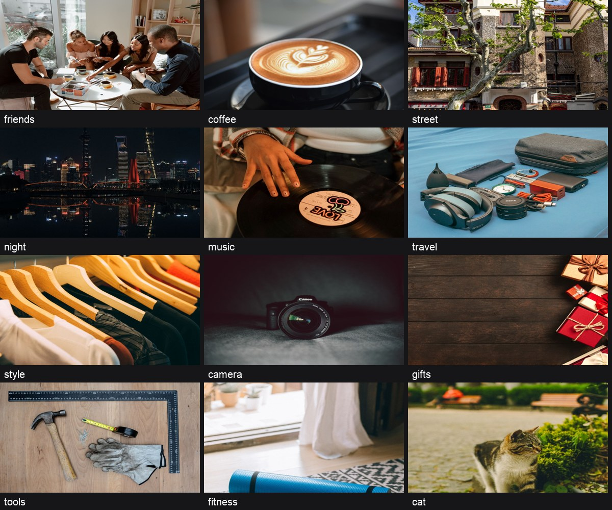

# 小程序活动清理与真实摄影封面候选

交付日期：2026-10-24（America/Los_Angeles）。

内容修改已完成；微信上传、正式发布和真机验收尚未执行。发版总门禁仍为 NO_GO：现有 5,103 条动作的动态验收证据待补，不能以本次单测通过代替。

## 用户确认的范围

- 不在后台删除活动，只修改新版本展示。
- 三组共 10 条旧测试内容全部从新版展示移除，主题模板和玩法模板保留。
- 采用真实摄影，不生成 AI 图片。
- 12 张封面上传到城瘾现有图片存储；此次只新增静态图片文件，没有修改数据库或重启服务。

## 已落实的改动

1. 首页推荐、主题列表、搜索、收藏和俱乐部主题列表共用请求入口过滤这 10 条记录。ID 和名称同时匹配；同名新活动及标记为模板的记录保留。与旧主题关联的活动同步过滤。旧主题分享链接在新版显示“该测试活动已下架”。
2. 主题模板列表、玩法模板列表、模板搜索结果、玩法详情的封面采用同一摄影映射，覆盖当次公开接口返回的全部 73 个玩法模板。模板 ID、复制配置入口和玩法规则保持原有行为，作者自传图片保留。
3. 图片存放在既有 HTTPS 静态图片域名，本地源文件保存在 `docs/assets/template-photos-20261023/`，不进入主包。12 张新图片共 140,318 字节，逐张服务器校验及公网重新下载后均完成完整 WebP 解码和 SHA-256 比对。

## 移除的旧测试内容

| ID | 名称 |
|---|---|
| 1 | 上海滨江 10KM 骑行 |
| 6 | 成都宽窄巷子辣味食材寻味 |
| 7 | 上海沉浸式戏剧 |
| 8 | 西安大唐不夜城灯光秀 |
| 990052 | 城市藏宝猎人 |
| 990053 | 异常事务局：不存在的坐标 |
| 990054 | 时间污染：被删除的今天 |
| 990055 | 末日广播：最后一座中继站 |
| 990056 | 野生邻居观察局 |
| 990062 | 预制人生 · 第一站 |

## 验证结果

| 层次 | 结果 | 证据 |
|---|---|---|
| 最终候选前端全量单测 | PASS，13,913 / 13,913；0 跳过 | `unit-tests.log` |
| 过滤真实 App 回调、模板保留、旧链接下架及图片一致性 | PASS，含正反例 | 单测 |
| 现有公开玩法模板摄影映射 | PASS，73 / 73 | `game-template-cover-coverage.json` |
| 12 张图片公网独立读回 | PASS，逐张完整解码、480×360、SHA-256 一致 | `photo-public-readback.json` |
| UI 静态门禁 | PASS | `ui-static-gate.log` |
| JS 作用域 | PASS，713 个生产 JS | `js-scope.log` |
| 隐私源码契约 | PASS | `node scripts/wechat-release-contract.js --source-only` |
| 动作清单静态 inventory | 5,103 个控件/ID 不变，仅 7 条 evidence 哈希更新 | `scripts/uiaudit/action-ledger.json` 差异 |
| 主包源码体积棘轮 | PASS，2.99MB ≤ 3.00MB | `release-preflight.log` |
| 整包发版前检查 | NO_GO：现有 5,103 条动作缺少动态验收证据 | `release-preflight.log` |
| 微信编译后实际包大小 | 未验证；仍需 preview/upload 的 info-output | 微信实际压缩后主包上限为 2MB |
| 微信上传、体验版/正式版和真机 | 未执行 | 本次不操作微信开发者工具 |

## 候选位置与数据边界

- 公开仓库分支：`feature/mini-content-refresh-20261023`，基于 `e1083c6c5`。
- 候选小程序目录：`chengyinhub-xcx/`。
- 原有工作目录及未提交改动均保留。
- 服务端旧记录仍存在，此处是新版客户端的展示清理；本次没有进行数据库删除或迁移。
- 主题模板接口在当次匿名只读盘点中返回空列表。本次保留模板接口及复制配置流程，没有创建占位主题来填充空态；摄影映射已覆盖已知主题模板名称，实际主题模板展示仍需真实数据及设备读回。
- 部分分页保留服务端总数，以免被当前页过滤数量截断后续内容加载；本次不修改服务端分页契约。

## 素材来源

照片来自 Pexels 的摄影作品，逐张来源、作者、许可和文件 SHA-256 见 `docs/image-sources/template-photos-20261023.json`。应用内使用遵循 [Pexels License](https://www.pexels.com/license/)。

