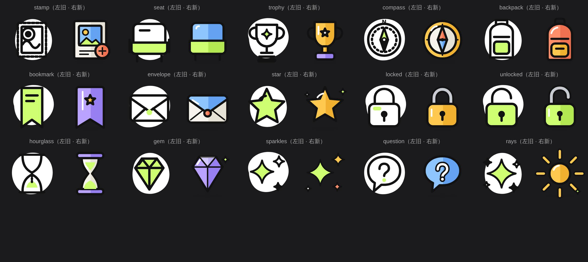

# DEC-UI-3 结果(2026-11-12)

分支 `claude/dec-ui-3-20261112`,从 `origin/master`(`1c80c5ae`)切出。落实业主 2026-11-11 决定页的三条裁决:D-118、D-82、D-93。

## D-118 · 15 枚旧图标统一风格

业主:「可以一起优化 整个app要统一风格的」。

- 清单(取自 l-iconsB RESULT「待你决定 2」):邮戳 stamp、席位 seat、奖杯 trophy、罗盘 compass、背包 backpack、书签 bookmark、信封 envelope、星 star、锁 locked、开锁 unlocked、沙漏 hourglass、宝石 gem、闪光 sparkles、问号 question、光芒 rays。
- 做法:补画进 `pages/play/components/cy-illus/art-b.js`,与已有 10 枚风格 B 同一套光影(右半深一档 + 左上白高光)、调色盘(柠檬绿 / 天蓝 / 珊瑚 / 金 / 紫 / 纸)、4.5 描边、120×120 网格、脚下软影。原型逐字段(sha256 单测)未动。
- 名字、`size` / `delay` / `bare` / `loop` 用法、`layers()` / `fg` / `blob` 返回形状不变,所有调用处无需改。图尺寸仍 120×120 画布。
- 旧画法(白色有机形底 + 单色手绘)已无调用,连同 `.il` 样式、`index.js` 旧分支、wxml 旧分支整体删除。
- 字节:四份 cy-illus 副本合计 **238,075 → 221,535**(−16,540,低于现状)。keyframes 未新增。
- 没有 MOTION 的新 15 枚只做通用弹出进场(与已有 B 图相同),不起待机计时。
- 对照图:`shots/icons-15-before-after-light.jpg`、`shots/icons-15-before-after-dark.jpg`(每格左旧右新,Chromium 逐层叠合渲染)。

## D-82 · 章节级奖励

业主:「加章节级奖励（需后端加字段）」。

- 字段:`cms_topic_chapter.reward_text VARCHAR(64)`,作者写的展示文案(≤24 字、无换行 / 控制字符,空 = 无奖励)。**只是展示,不发放任何东西**;积分类奖励需要发放台账 / 幂等 / 限额,不在本次范围。
- 迁移:新文件 `chengyinhub-admin/sql/migration_20261112_chapter_reward.sql`(幂等,仿 `migration_20261105_chapter_video.sql`),登记 `ci/migration-dependencies.json`。**PR 描述里已声明该迁移**(迁移安全检查要求)。
- 后端:实体 / DTO / mapper(resultMap、select 列、动态 insert / update)、写入校验 `ChapterRewardText` + `TopicContentWriteGuard`、编辑器保存走既有 `updateTopicByOwner`(仅创建者可改,非创建者在任何章节写入前被拒)、管理端章节 CRUD 同样校验;新版本重开 / 主题复制带上该字段;玩家端 `/api/play/nodes` 返回 `chapters[].rewardText`,新开局读发布时冻结值,旧发布读现行行。
- Java 测试(已写,CI 跑):`ChapterRewardTextTest`、`ChapterRewardMapperSqlTest`、`TopicUpdateByOwnerTest`(归属 / 校验 / 空值)、`TopicPublicationContentSnapshotTest`、`PlayFrozenChapterProjectionTest`,及 6 处集成夹具补列。
- 小程序:编辑器章节设置加「章节奖励」输入(复用章节名输入样式,maxlength 24,序章 / 结局章不显示);章节结束卡仅在有值时多一行 `奖励 · …`(`chapter-flip/index.wxml` 一行,复用 `cf__stats2` 样式,零新增 wxss / 资源 / 组件)。
- 体积:`pages/play` 源码 +284 B(未编译口径;2041/2048 KiB 的编译口径需开发者工具实测)。
- 未做:RuoYi 管理端 Web UI(`chengyinhub-ui`)没有该字段输入;AI 草稿 / 模板复制映射不带 `rewardText`(来源本无此值)。

## D-93 · 营销首页与店铺参谋合并一套指标

业主:「合并成一套」。

- 重叠指标:核销数(本期 / 上期 / 变化率 / 按日)。营销首页读 `analytics.stages` 的 VERIFY(同 `/funnel`),店铺参谋读 `trends.windows[7/30/90]` 与 `facts.attribution`,两处各算一份,口径还不同(自然日 vs 滚动 30×24h;时区也不同)。
- 统一口径:取营销首页的——Asia/Shanghai 自然日(含今天)、`[currentStart, endExclusive)`,上期为紧邻的前 N 天;核销 = 归属商家的 ACTIVE `redemption` + 其活动的验票,按事件时间各计一次(与「核销与退款」台账一致);变化率 4 位小数,上期为 0 时为 null。
- 新增共用服务 `IMerchantMetricsService` / `MerchantMetricsServiceImpl` / `MerchantMetricPeriod` / `MerchantVerifyMetric`;`MerchantAggregateReadServiceImpl`(营销首页)与 `MerchantInsightServiceImpl`(店铺参谋)都调它;删除各自的窗口 / 归因 / 默认时区日期算法与 `selectAnalytics` 里的 VERIFY 统计(新增 `selectVerifyEventTimes`)。缓存键 v3 → v4。
- 店铺参谋返回新增 `changeRates`,小程序 `ai-insight` 的 `_buildHero` 改读服务端值,删除端上 `(cur-prev)/prev`。响应形状除此外不变,商家归属校验不变。
- **数值会变**:店铺参谋的核销数口径对齐后通常 ≥ 旧值(旧口径漏了活动验票、话题报名核销、已下架优惠的历史核销)。注册队列类事实(核销率、复购率、等待时长、时段)与曝光不在营销首页出现,保持原样。
- Java 测试(已写,CI 跑):`MerchantMetricsParityTest`(同一服务喂两个入口:7 / 30 天与归因卡数值一致、按日求和 = 窗口总数、零数据、上海零点半开区间、商家 B 看不到商家 A、缺 owner / 不支持窗口被拒);更新 `MerchantAggregateReadServiceTest`、`MerchantDiscoveryMemberIdProjectionTest`、`MerchantInsightServiceImplTest`、`MerchantMarketingAnalyticsMapperContractTest`、`MerchantNumbersAgreeMyBatisTest`、`RegistrationReadContractMybatisIntegrationTest`。

## 闸门

- 全量小程序单测(`node --test tests/unit/*.test.js`,17,494 条):首次 2 条失败,均为 `action-ledger.test.js` 写死的计数(D-82 新增 1 个编辑器输入:事件合同 2996 → 2997、总数 6025 → 6026,另有本地事件合同 2897 → 2898),已按重建实测改并注明 D-82;改后 `action-ledger.test.js` 48/48 通过。
- `node tests/lint/ui-integrity.js`:**UI-GATE-0:PASS**,无新增基线。
- 动作台账 `build-action-ledger.js --write` 已重建并提交(6026 控件),`--check` 通过;路由矩阵 `build-route-matrix.js --check` 通过(171 路由,无变化)。
- WXS 语法门禁(`--expose-internals`)通过;WXSS 选择器 / 组件选择器 / 注释入值三项通过;危险确认门禁 DANGER-GATE PASS。keyframes 棘轮、`motion-property-ratchet`、`reduced-motion-coverage-contract` 含在全量单测内,通过。
- 契约测试按 D-118 更新:`l-iconsB-20261111`、`launch-look-tokens-illus`(旧画法断言改为风格 B)。
- 没有跑 `ci/xcx-check.sh` 与 `ds-hardcode-gate-selftest.sh`。
- Java:本环境不跑 Maven / Java,测试交 CI。

## 待你注意

1. **`ci/architecture/baseline.json`**:其中有 `MerchantMarketingAnalyticsMapper.xml#selectAnalytics` 的 sha256;D-93 改了这段 SQL 并新增 `selectVerifyEventTimes`。按约定我没有改 `ci/architecture/*`,CI 的架构门禁很可能因此变红,需要你(或有权限的后续工单)更新基线。
2. 迁移 `migration_20261112_chapter_reward.sql` 需用户经既有流程在测试库 / 生产库执行;本 PR 不部署。
3. 真机未验:新 15 枚图标的 data URI SVG(`clip-path="inset()"` 暗面)在 iOS / 安卓 WebView 的渲染(与已有 B 图同类写法);`pages/play` 编译后体积(开发者工具)。
4. 没有模拟器截图(环境无微信开发者工具),图标对照图为浏览器渲染。

STATUS: PARTIAL - Java 测试与 ci/architecture 基线未在本环境验证(按约定不跑 Java、不改 ci/architecture),需 CI 确认
