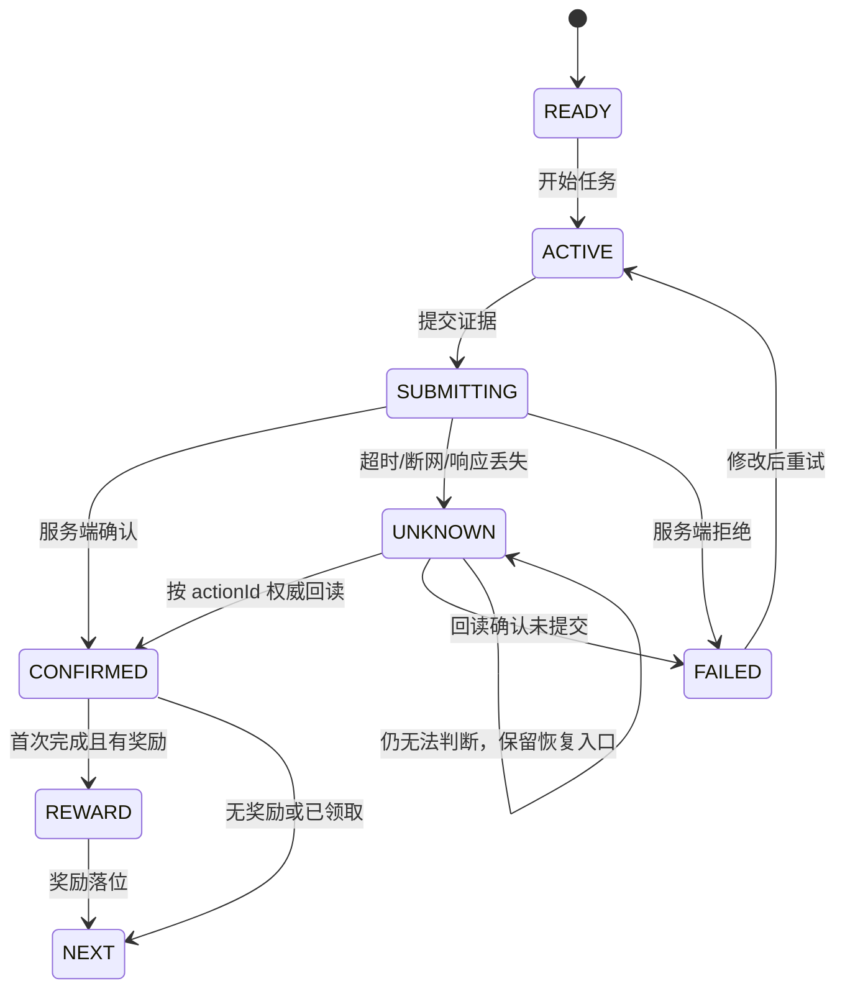
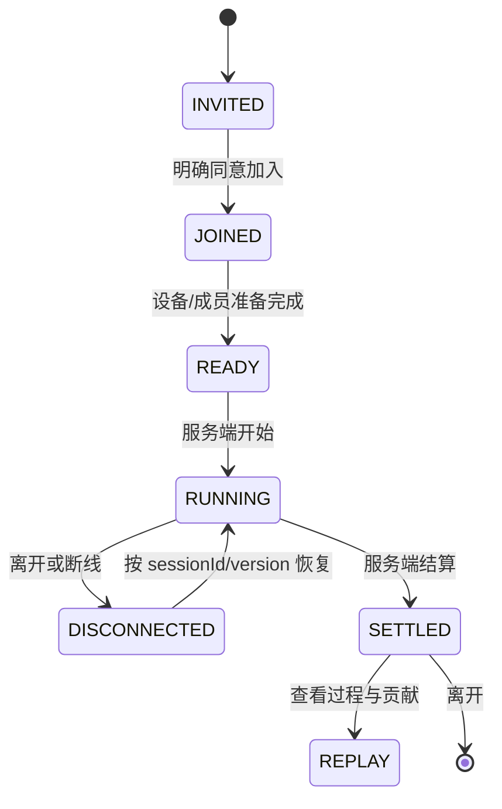

# Figma 玩法游戏 UI·动效稿：小程序参考落地施工文档

> 文档日期：2026-08-23  
> Figma 来源：[城瘾玩法游戏 UI·动效稿 / Page 7 / node 220:573](https://www.figma.com/design/hHQwsqHYsLAmwDokGh9okO/%E5%9F%8E%E7%98%BE%E7%8E%A9%E6%B3%95%E6%B8%B8%E6%88%8FUI%C2%B7%E5%8A%A8%E6%95%88%E7%A8%BF?node-id=220-573)  
> 代码核对基线：`github/master@133c62f0d4e78db496efba071574550d5cc88f67`  
> 状态：施工设计稿，未代表已开发、已通过微信开发者工具、已真机验证或已上传微信

## 1. 结论

这批参考基本都能转化到城瘾小程序，但不应按参考图逐页复制，也不需要重新造一套游戏壳。

当前 `github/master` 已经具备雾地图、路线进度、拆包、拍照/扫码/GPS/答题、身份卡、组队进度、动态票券二维码、集邮册、徽章墙、3D 徽章、结算回顾、动效降级等基础能力。下一阶段最有价值的不是继续堆页面，而是把这些能力收束成四条统一体验：

1. 进入玩法后始终明确“现在只做什么”；
2. 每次写操作都有提交中、成功、未知、失败和权威回读；
3. 单人、组队、现场活动共享同一套进度和奖励语义；
4. 动效只解释状态变化，不承担唯一信息，不制造虚假完成感。

建议采用“复用交互骨架、重做城瘾资产、绑定真实业务回执”的落地方式。传感器玩法、3D 路线回放、后台持续定位和异常联系人升级，不进入第一期。

## 2. 本文与现有文档的边界

本文只负责 Figma 参考稿到小程序的 UI、交互、状态、动效和验收施工映射，不替代以下已有设计：

- `三身份游戏模组产品说明与实施TODO_20260823.md`：负责玩家、商家、俱乐部三身份的业务模块和权限边界；
- `城市定向分支剧情路线TODO_2026-08-23.md`：负责分支剧情和服务端权威路线；
- 本文：负责用户看到什么、按下后发生什么、异常后如何恢复，以及如何证明没有“假绿”。

## 3. 证据与限制

### 3.1 已检查内容

- Figma `220:573` 下共 22 个参考板块；
- 其中的参考来源矩阵、地图体验、社交循环、现场任务、安全到场、低说明成本等关键画板；
- 最新 `github/master` 的小程序页面、组件、工具函数、注册分包和相关后端 Controller；
- 当前渲染与动效能力：原生小程序 WebView 路线，尚未看到 Skyline/worklet 的生产接入。

### 3.2 本文不能证明

- Figma 静态画板不能证明完整原型时序和最终动效参数；
- 源码存在不能证明微信开发者工具可运行、真机权限可用、接口已部署或前端已上传；
- 本次没有把 Figma 外部产品的图片、品牌、字体或视频素材视作可直接商用资产；
- 所有线上状态、数据库状态、微信版本状态仍需各自独立回读。

## 4. 参考稿采用规则

### A 类：直接复用交互骨架

可以参考状态关系和手势逻辑，但视觉资产必须城瘾化：

- Roadmap：路线、节点、当前任务、完成反馈；
- Shared Element：卡片到详情、地图点到任务面板的连续过渡；
- Draw Path Reveal：沿路线拖动或绘制后揭示内容；
- 一次只呈现一个当前动作；
- 组队总进度与个人贡献并列；
- 可离开、可恢复、可重试的异步任务。

### B 类：重做素材后使用

- 金币、宝箱、徽章、贴纸、邮票、花束成长；
- 地图转场、聚光灯、庆祝粒子、卡片轮播；
- 撕包、刮开、拉链、旋转、拖拽等直接操控；
- 角色、城市地标、路线纹理和音效。

这些内容必须由城瘾自己的视觉规范、版权素材和真实奖励数据驱动，不能把参考稿截图切片后上线。

### C 类：禁止照搬或暂缓

- 二维码主体不能动画、变形或被遮挡；只允许外围光效和状态提示；
- 不用动画伪造“提交成功”“已到账”“已解锁”；
- 不在小程序第一期模拟 App 才能可信采集的传感器证明；
- 不把后台定位、紧急联系人、异常上报默认打开；
- 不在没有真机性能基线前上线 3D 路线飞越或大规模逐帧动画；
- 不根据外部产品外观重制其品牌标识或受保护素材。

## 5. 22 个参考板块的施工映射

| Figma 参考主题 | 小程序现状 | 落地动作 | 优先级 | 边界 |
|---|---|---|---|---|
| 源稿重构、Roadmap、金币、路径揭示 | `pages/play/index` 已有路线、拆包、奖励和节点 | 收束为统一 Roadmap + 当前任务 + 奖励回执 | P0 | 只复用机制 |
| 60fps 路线、宝箱、庆祝 | 已有 `cy-celebrate`、结束页和里程碑 | 建立语义动效序列，不做逐帧复刻 | P0 | 降低动态时直达终态 |
| 周进度、卡片轮播、邮票抽出 | 已有集邮册、成长和活动记录 | 将周进度与真实记录绑定，补详情连续过渡 | P1 | 不虚构连续签到 |
| 3D 路线回放、宝石、收藏网格 | 已有 2D 路线回顾、3D 徽章、徽章墙 | 先补 2D 回放信息结构，3D 路线后置 | P2 | 真机性能门禁 |
| 雾地图、任务导航、旅行回忆 | `pages/roam`、`free-map`、历史和 POI 已有 | 统一发现→任务→到达→回忆的状态语义 | P0 | 位置权限可拒绝 |
| 拍照贴纸、角色成长、结算分享 | 拍照、成长、结算和分享已分散存在 | 统一证据卡、奖励卡和分享卡 | P0 | 分享不得泄露精确位置 |
| 组队挑战、异步同行、共同成长 | team、club、circle 已有多套能力 | 统一会话、成员、贡献、离开与恢复 | P0/P1 | 默认合作，不强迫排行 |
| 地图点亮、2D/3D 转化、进度生长 | 地图与徽章已有视觉基础 | 用于解释解锁和成长，不做装饰性常驻动画 | P1 | 无动画也要可理解 |
| 直接操控：撕、刮、拖、回弹 | 拆包已存在 | 抽成统一手势阈值和可访问替代入口 | P1 | 每种手势都有按钮替代 |
| 真实任务、AR 导向、多通道风险提示 | 已有拍照、扫码、GPS、答题 | 做证据状态与无障碍冗余；AR 不进 P0 | P0/P2 | 文本、图标、触觉冗余 |
| 共同决策、共享清单、轻压力陪伴 | circle/team/club 已有 | 增加投票理由、共享顺序、正向反馈 | P1 | 不制造输家或羞辱性文案 |
| 现场任务、签到、候补、人工兜底 | official、ticket、verify 已有 | 统一签到票券、凭证状态与人工恢复入口 | P0 | 二维码必须可扫描 |
| 到场、安全、延迟和异常 | 部分位置与活动状态已有 | 只做前台、会话级自愿共享和到场恢复 | P1 | 法务/权限决策前不升级联系人 |
| 感知发现、设备输入、直播下一步 | `/sensor-result` 存在但可信证明受限 | P0 只做相机/扫码/GPS；传感器 App-first | P2 | 不允许前端自证完成 |
| 公平竞赛 | 已有 leaderboard | 默认显示个人进步和标准化贡献，排行可关 | P1 | 不用原始活动量直接比较 |
| 共享会话 | circle/celebration/advanced-game 已有 | 统一 ready/running/settled/replay 与重连 | P1 | 版本号和幂等必须服务端权威 |
| 可逆挑战、低说明成本 | 多种任务类型已有 | 单动作、明确成本、可退出、可恢复、可重试 | P0 | 失败收据用中性语言 |

## 6. 目标信息架构

不新增平行的“游戏中心 2.0”。继续以现有页面为主：

```text
活动/漫游/俱乐部入口
└── 玩法壳 pages/play/index
    ├── Roadmap：全局进度与当前节点
    ├── Mission Sheet：当前唯一动作
    ├── Proof：拍照 / 扫码 / GPS / 答题 / 选择
    ├── Receipt：提交中 / 已确认 / 未知 / 失败
    ├── Reward：首次奖励 / 已领取 / 收藏落位
    └── Review：路线、贡献、回忆、下一步

共享玩法
├── pages/play/circle/index
├── pages/team/detail
├── pages/club/progress
└── pages/play/celebrate/index
```

设计原则是“一套状态，多种入口”。活动、漫游、俱乐部可有不同皮肤和文案，但不各自发明完成、奖励、重试和重连逻辑。

## 7. P0 施工包

### P0-1：Roadmap 与“当前唯一动作”

目标：用户进入玩法后，3 秒内能知道当前位置、当前任务、完成条件和下一步。

施工内容：

- 在 `pages/play/index` 现有路线能力上统一节点视觉：未解锁、可开始、进行中、待确认、已完成、异常；
- 首屏只突出一个主 CTA；次要入口放入任务详情或更多操作；
- 节点点击打开同一个 Mission Sheet，不为不同任务另造页面；
- 路线卡展开到地图时保留同一个节点身份，避免用户丢失上下文；
- 任务完成后先显示服务端确认，再点亮路线和奖励；
- 回到页面时根据服务端 session/version 恢复，不依据本地动画进度推断完成。

验收：

- 每个可见按钮都能进入下一状态或给出明确原因；
- 当前节点只有一个；
- 锁定节点必须展示解锁条件；
- 关闭动效后流程、信息和结果完全等价。

### P0-2：统一任务证据与权威回执

覆盖拍照、扫码、GPS、答题、偏好选择和普通确认动作。



必须使用的用户文案语义：

- `SUBMITTING`：正在提交，避免重复操作；
- `UNKNOWN`：尚未确认结果，不得写“失败”或“成功”；
- `FAILED`：说明可修复原因与下一步；
- `CONFIRMED`：只有服务端确认后才点亮完成态；
- `REWARD`：明确首次奖励、重复提交和已领取的区别。

禁止：

- 请求超时后直接重试写入；
- 依靠本地缓存把任务标成完成；
- 播完奖励动画就增加余额；
- 用 toast 代替可恢复状态。

### P0-3：地图发现到任务完成的统一链路

链路：雾地图发现 → POI 信息 → 任务说明 → 到达/证据 → 路线点亮 → 回忆沉淀。

施工内容：

- 复用 `pages/roam`、`subpackageRoam` 和 `cy/free-map`，不另建地图；
- 地图点位必须显示发现、可达、当前、完成、暂不可用五类语义；
- 定位拒绝时提供列表浏览、手动选择区域或扫码等替代路径；
- 偏航只提示“重新查看路线/返回任务”，不自动判失败；
- 完成后的照片、邮票、路线记录写入真实历史，不生成不存在的“旅行回忆”；
- 分享卡默认去除精确坐标和敏感时间信息。

### P0-4：奖励、收藏与结算

统一奖励顺序：

1. 服务端确认完成；
2. 返回奖励 receipt；
3. 播放可跳过的获得反馈；
4. 奖励落入邮票册、徽章墙、成长或余额中的真实位置；
5. 提供“查看收藏”和“继续下一步”。

重点改造：

- `cy-celebrate` 只负责表现，不负责写业务状态；
- 邮票、徽章、成长和余额必须带稳定 ID，可在详情页回读；
- 重复完成返回“已记录/已领取”，不重复飞入余额；
- 结算页同时展示完成路线、个人贡献、团队进度和下一步；
- 分享是次要动作，不能拦住领取或离开。

### P0-5：活动签到、票券和现场恢复

施工内容：

- 统一报名成功、候补、已出票、已核销、待确认、异常六类票券状态；
- 动态码由服务端生成并按现有规则刷新，二维码主体静止；
- 周围可以使用轻量呼吸光、刷新倒计时和网络状态，但不得覆盖定位点；
- 提供亮度提示、手动编号、活动名单或工作人员核验等现有业务允许的兜底；
- AI/自动识别失败时允许重拍、改用其他凭证或进入人工处理；
- 任何人工兜底必须留下可追踪结果，不能只在前端放行。

### P0-6：无障碍与动效降级

- 复用现有 `motion-preference.js`、`font-scale.js` 和主题能力；
- 所有手势任务必须提供等价按钮；
- 颜色之外至少再用文字、图标或形状表达状态；
- 重要风险反馈使用大语义文本 + 图标 + 可选触觉，声音不能是唯一反馈；
- 大字体不能遮挡任务条件、主 CTA、二维码或倒计时；
- 降低动态时移除路径飞行、弹性缩放、粒子和连续视差，直接呈现最终状态；
- 触觉只用于完成、警告和可拖动阈值，不对普通点击滥用。

## 8. P1 施工包

### P1-1：共享会话与恢复

统一 circle、team、club、celebration 的会话语义：



要求：

- 用户明确加入，不因打开链接自动共享；
- 成员列表、顺序、投票、答案、贡献和结算均带 session version；
- 重连后展示“错过了什么”，而不是重放所有动画；
- 房主退出、成员掉线、活动暂停和重复结算都有明确规则；
- 正常状态只共享必要进度，异常信息先帮助恢复，再按授权范围升级。

### P1-2：公平竞争和低压力协作

- 默认入口是团队共同目标和个人成长，不是排行榜；
- 排行榜提供“仅自己/不参与展示”；
- 跨用户比较优先使用任务完成率、有效贡献或规则归一后的分数；
- 原始步数、在线时长、消费额等不能直接当公平能力排名；
- 使用预设正向消息，避免“拖后腿”“垫底”等文案；
- 未连续参与不清空长期收藏，不用焦虑性倒计时逼迫返回。

### P1-3：直接操控与连续过渡

- 拆包、刮开、绘制路径只在其能解释“揭示/选择/探索”时使用；
- 建立统一手势阈值、取消区、完成区和触觉反馈；
- 页面切换优先使用卡片/地图点的连续身份，而不是全屏炫技；
- 使用 `WXSS transition/keyframes` 做简单状态变化；
- 需要节点连续移动时再评估小程序原生 `this.animate()`；
- 禁止用高频 `setData` 驱动逐帧动画。

## 9. P2 研究项

### P2-1：3D 路线回放

先完成 2D 路线回放的信息和交互验收，再单独做 3D 技术样机。样机必须验证：

- 首屏、包体、内存、帧率和低端机表现；
- 暂停、跳过和降低动态；
- 页面隐藏和返回后的资源释放；
- 3D 不得成为读取路线结果的唯一方式。

### P2-2：Skyline/worklet 动效试点

当前生产代码仍以 WebView 路线为主。若需要复杂手势和线程动画，应在一个独立、可回退的页面试点，不直接全局切换 renderer。

### P2-3：设备传感器玩法

后端已有 `/api/play/sensor-result`，但可信完成证明目前更适合 App。小程序侧在建立服务端可信证明、设备能力矩阵和防伪策略前，不得由前端自行上报“已完成”。

### P2-4：到场安全升级

持续位置共享、异常联系人、后台定位或超时升级必须先补产品、法务、权限、保留期限和撤回机制；第一期只做前台会话、最小必要数据和自愿开启。

## 10. 服务端数据契约

### 10.1 现有接口优先复用

- `/api/play/*`：节点、完成、签到、答题、提示、偏好、到达、拍照、成长、成就；
- `/api/play/advanced/*`：高级玩法会话、动作、状态、排行；
- `/api/team/*`：建队、入队、处理申请、退出、踢人、解散；
- `/api/club/lead/*`：到达、开场、解锁章节、广播、团队进度、结算；
- `/api/circle-theme/*`：主题邀约、会话、加入、记录、答案、卡片、回顾；
- `/api/celebration/*`：庆祝板、槽位、投票、签收、收藏；
- `/api/official/*`：官方活动、报名、进度、到场、组队和状态控制；
- `/api/roam/stamp/*`：邮票创建与列表；
- `/api/verify/*`：动态码、城市节点码、群码签发与核销。

### 10.2 前端需要的统一只读模型

以下是目标语义，不要求一次性新增一个巨型接口；可在现有接口逐步补齐：

```json
{
  "session": {
    "sessionId": "stable-id",
    "version": 12,
    "status": "RUNNING",
    "currentNodeId": "node-id",
    "updatedAt": "server-time"
  },
  "node": {
    "nodeId": "node-id",
    "status": "ACTIVE",
    "proofType": "PHOTO",
    "proofStatus": "READY",
    "unlockReason": null,
    "contribution": 20
  }
}
```

### 10.3 每次写操作必须有回执

```json
{
  "receipt": {
    "actionId": "server-action-id",
    "idempotencyKey": "client-generated-stable-key",
    "actionType": "PLAY_PHOTO_SUBMIT",
    "status": "CONFIRMED",
    "firstTime": true,
    "committedAt": "server-time",
    "nextNodeId": "next-node-id",
    "rewardRefs": ["badge:123"]
  }
}
```

约束：

- 服务端按用户、业务对象、动作类型和幂等键判定重复；
- 超时后按 `actionId` 或 `idempotencyKey` 读取对面产生的事实；
- `UNKNOWN` 必须保留业务锁和恢复入口，不能自动重复写；
- 奖励、贡献、完成时间和下一节点由服务端返回；
- 前端只能渲染 receipt，不从动画、本地计数或请求 exit 0 推导成功；
- 共享状态使用 version 做并发控制，旧响应不能覆盖新状态；
- owner、角色和活动范围校验必须在服务端完成。

## 11. 前端模块施工建议

以最小改动为原则，先扩展现有能力，再判断是否需要新组件。

| 路径 | 施工责任 |
|---|---|
| `chengyinhub-xcx/pages/play/index.*` | Roadmap、Mission Sheet、任务状态、结算编排 |
| `chengyinhub-xcx/pages/play/circle/index.*` | 共享会话、加入、重连、回顾 |
| `chengyinhub-xcx/pages/play/celebrate/index.*` | 服务端确认后的庆祝和收藏落位 |
| `chengyinhub-xcx/pages/roam/index.*` | 雾地图、发现、当前任务入口 |
| `chengyinhub-xcx/subpackageRoam/**` | 历史、POI、路线与回忆 |
| `chengyinhub-xcx/components/cy/advanced-game/**` | 会话版本、动作回执和多人状态 |
| `chengyinhub-xcx/components/cy/free-map/**` | 点位状态、路线揭示、替代入口 |
| `chengyinhub-xcx/components/cy/celebrate/**` | 纯表现层；支持跳过和降低动态 |
| `chengyinhub-xcx/pages/play/components/scene-qr-ticket/**` | 静态可扫码主体、刷新和异常状态 |
| `chengyinhub-xcx/utils/write-action-workflow.js` | 统一提交、未知、回读和业务锁 |
| `chengyinhub-xcx/utils/verification-readback.js` | 从手工台账升级到请求相关的服务端事实回读 |
| `chengyinhub-xcx/utils/motion-preference.js` | 动效偏好和降级 |
| `chengyinhub-xcx/utils/font-scale.js` | 字体缩放和布局策略 |

只有 Roadmap 或 Action Receipt 在两个以上业务页面复用后，才新增公共组件；否则先留在功能页内，避免提前抽象。

## 12. 动效系统

### 12.1 动效分层

| 层级 | 用途 | 示例 | 降低动态 |
|---|---|---|---|
| 导航 | 解释空间和来源 | 地图点到任务卡、卡片展开 | 淡入或直接切换 |
| 反馈 | 解释操作是否被接收 | 拖拽过阈值、提交中、选项确认 | 颜色/图标/文本变化 |
| 状态 | 解释业务变化 | 路线点亮、进度增长、奖励落位 | 直接显示终态 |
| 庆祝 | 增强首次完成情绪 | 邮票滑入、徽章出现、轻粒子 | 静态成功卡 |

### 12.2 技术路线

1. 优先沿用现有 motion token 和 WXSS transition/keyframes；
2. 连续节点移动确有价值时使用小程序原生动画 API；
3. 不引入 GSAP 等 Web 动画库；
4. 不用高频 `setData` 做帧动画；
5. Skyline/worklet 只在独立试点通过后使用；
6. 动效时长和曲线最终以 Figma 原型时序、开发者工具和代表性真机共同定稿，不在业务代码散落魔法数字。

### 12.3 动效与业务状态的硬边界

- 动画开始不等于请求开始；
- 动画结束不等于服务端提交成功；
- 页面出现成功卡之前必须已有服务端确认；
- 动画取消、页面隐藏或进程中断不能改变业务结果；
- 恢复页面时直接读取业务状态，不续播可能误导用户的中断动画。

## 13. 视觉与资产施工

- 保留城瘾现有主题色、字体层级、暗色模式和身份色；
- Figma 参考只用于构图、层级、节奏和交互研究；
- 地图纹理、角色、徽章、邮票、插画、音效由城瘾重新制作并记录授权；
- 不将 Figma 临时下载 URL 写入代码；
- 不将外部产品截图、Logo、专属角色或品牌字体放入包体；
- 新资产提供普通、暗色和必要的高对比版本；
- 新增大图先评估分包、压缩和按需加载；
- 二维码必须使用高对比、无遮挡、无变形的静态主体。

## 14. 测试与负控

### 14.1 合同和单元测试

- 每个状态枚举都有已知值和未知值的 fail-closed 测试；
- `null/unknown` 与 `0/未完成` 分开；
- 同一幂等键重复提交只能产生一次业务效果；
- 旧 version 响应不能覆盖新 version；
- 非 owner、错误角色、错误活动范围写入必须被拒绝；
- 奖励重复提交返回已领取，不重复增长；
- 动态码过期、刷新和核销状态可回读。

### 14.2 小程序自动化与开发者工具

至少覆盖：

- 所有入口和可见按钮都可点击并进入下一步；
- 首页进入玩法、地图进入任务、任务完成到收藏、共享链接加入会话；
- 相机拒绝、定位拒绝、扫码取消、上传失败、接口超时、响应丢失；
- `UNKNOWN` 状态刷新、退出后返回、冷启动恢复；
- 大字体、暗色、降低动态；
- 二维码无遮挡和真实扫码；
- 不同身份、无权限和过期活动的禁用状态；
- 分享卡不包含精确位置或不应公开的成员信息。

### 14.3 真机门禁

- 至少覆盖一台低性能 Android 和一台主流 iPhone；
- GPS、相机、扫码、触觉、页面切后台和弱网恢复必须真机验证；
- 记录首屏、交互响应、内存和长列表表现的改造前基线；
- 性能阈值在基线和目标设备确认后固化到验收表，不凭空写一个看似精确的数字。

### 14.4 必做负控

- 把成功 receipt 改成 `UNKNOWN`，确认路线和奖励不会点亮；
- 模拟同一动作重复返回，确认奖励不重复；
- 返回旧 version，确认界面不回退；
- 移除 owner/scope，确认写接口红；
- 开启降低动态，确认不执行非必要动画但信息完整；
- 遮挡或变形二维码的测试夹具必须让可扫码门禁红；
- 模拟断线后重连，确认从服务端恢复而不是从本地假恢复。

## 15. 分期和依赖

| 阶段 | 内容 | 前置 | 完成证据 |
|---|---|---|---|
| 0 | 状态词典、receipt、session/version 合同 | 产品与后端确认 | 合同测试先红后绿 |
| 1 | Roadmap、当前任务、证据提交、异常恢复 | 阶段 0 | 自动化 + DevTools |
| 2 | 地图链路、奖励收藏、结算、票券 | 阶段 1 | 自动化 + 真机扫码/GPS/相机 |
| 3 | 共享会话、团队贡献、公平竞争 | session/version | 多账号、多设备、断线恢复 |
| 4 | 直接操控和连续过渡 | 核心流程稳定 | 降低动态 + 性能回归 |
| 5 | 3D、Skyline、传感器、安全升级研究 | 独立立项和权限决策 | 技术样机与专项 Go/No-Go |

不建议先做阶段 4、5，再补阶段 0、1。炫目的动效不能替代可恢复的业务状态。

## 16. DoD 与 Go/No-Go

### 单个功能完成定义

- 设计态、空态、加载态、成功态、失败态、未知态和恢复态齐全；
- 每个按钮、手势和返回路径能走到下一步；
- 写操作有幂等键、服务端回执和权威回读；
- 动效可跳过、可降级，不承载唯一信息；
- 大字体、暗色、权限拒绝和弱网可用；
- 自动化、开发者工具和相关真机验证通过；
- 至少一个独立负控能把门禁变红，再恢复为绿；
- 没有外部品牌资产、临时 Figma URL、mock 成功或本地假完成。

### 发布判定

以下证据彼此独立，不能互相替代：

1. 源码和测试通过；
2. GitHub CI 通过；
3. 后端接口和生产版本回读通过；
4. 必要数据库迁移/配置已按安全流程执行并回读；
5. 微信开发者工具验证通过；
6. 代表性真机验证通过；
7. 微信版本已上传并读取到目标版本信息。

任一必须项没有证据，只能报告“该层未验证”，不能报告整体已上线。

## 17. 首轮施工清单

- [ ] 锁定统一状态词典：node、proof、receipt、session、reward；
- [ ] 为现有写接口盘点幂等键、actionId 和读回路径；
- [ ] 给 `pages/play/index` 画出 Roadmap + Mission Sheet 状态稿；
- [ ] 选拍照任务做第一个完整纵切：进入→提交→未知→回读→奖励；
- [ ] 用同一套组件接入扫码和 GPS，验证没有按任务复制逻辑；
- [x] 把 `cy-celebrate` 约束为纯表现层；（2026-08-25 核实：41 行、零 request / 零 setStorage，本就成立，无需改造）
- [ ] 打通奖励落入邮票/徽章/成长详情的回读；
- [ ] 补共享 session/version 和重连摘要；
- [ ] 补权限拒绝、弱网、重复提交和旧版本负控；
- [ ] 在开发者工具和代表性真机完成截图、行为和性能证据；
- [ ] P0 通过后再选择一个拆包或路径绘制作为 P1 动效样板；
- [ ] 3D、传感器和后台安全能力另开专项，不混入 P0。

## 18. 设计评审摘要

### 做得好的方向

- 参考稿强调“现实任务→证据→反馈→长期收藏”，与城瘾现有业务最匹配；
- 地图、路线、邮票、徽章、组队和现场活动已经有代码承载点，不需要重建产品架构；
- 可逆挑战、低压力协作、单一当前动作和多通道反馈，适合真实城市环境中的注意力和网络限制。

### 当前主要风险

- 已有能力分散在 play、roam、team、club、circle、celebration，多套状态容易互相不一致；
- 写操作若只有请求成功 toast，没有请求相关的服务端事实回读，会出现“看起来完成、实际没到”的假绿；
- 共享会话、排行和到场安全如果缺少 opt-in、version 和最小数据边界，会带来隐私和并发问题；
- 先追求 3D/复杂动效会放大低端机、包体、可访问性和恢复成本。

### 建议决策

批准 P0：统一状态、回执、Roadmap、任务证据、奖励落位、票券恢复和无障碍。  
条件批准 P1：共享会话、公平竞争和直接操控，必须建立在 P0 合同之上。  
暂缓 P2：3D 路线、Skyline 全局迁移、传感器完成证明和后台安全升级。
