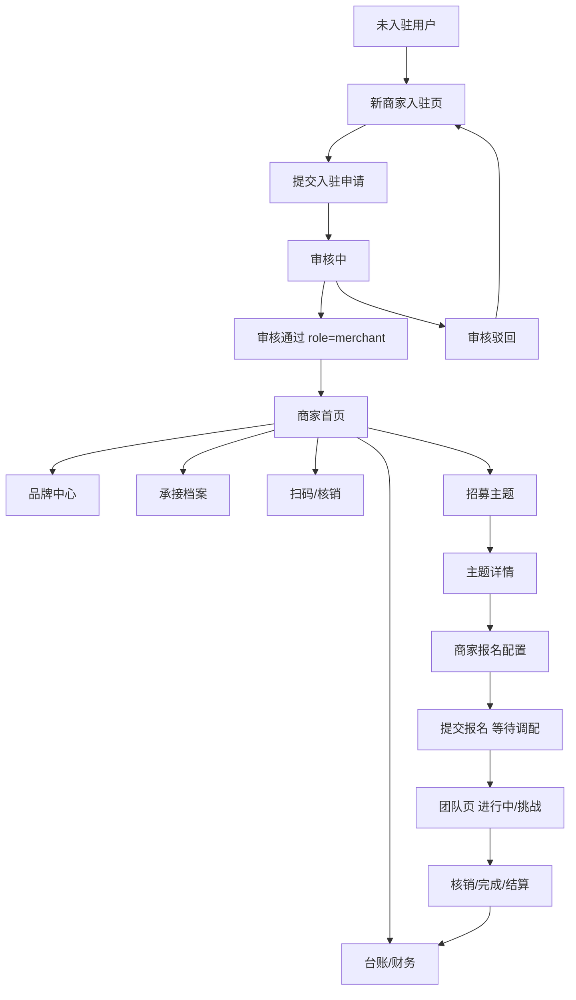

# 商家整体流程问题审计与整改 TODO

日期：2026-06-27
范围：城瘾小程序商家端页面、商家入驻、品牌中心、主题报名、核销、台账、合作承接、角色权限口径。

## 1. 结论

商家端当前已经有完整骨架：商家首页、入驻、品牌中心、主题招募、报名配置、核销、台账、公开主页、承接档案、合作邀请都存在，也接入了一批真实后端接口。

但它现在还不是一个闭环的商家工作台。核心问题不是“缺页面”，而是页面职责分散、老新流程并存、状态口径不统一、商家操作没有沉淀到统一工作流里。整改目标应当是把商家端收敛为：

1. 新商家入驻页负责申请。
2. 品牌中心负责资料维护。
3. 商家首页负责经营总览和待办入口。
4. 团队页承载商家参与中的项目、进行中任务和挑战。
5. 台账页承载订单、核销、售后和结算。
6. 合作页承载承接档案、邀请和对接状态。

## 2. 已确认决策

### 2.1 商家身份口径

确认：以 `role=merchant` 作为商家身份标准，`user_type=2` 只作为历史兜底。

当前风险：

- 前端部分页面已经按 `role` 优先判断商家身份。
- 后端部分接口仍只判断 `userType == 2`，会出现“能进商家首页，但不能报名主题”的断裂。

整改方向：

- 后端商家专属接口统一使用 `roleService.resolveRole(member)` 判断是否为商家。
- 前端保留 `role` 优先、`userType` 兜底的过渡策略。
- 不再新增只依赖 `user_type` 的商家判断。

### 2.2 商家入驻页

确认：使用新的商家入驻页：

`chengyinhub-xcx/pages/merchant/apply/index`

旧入驻页：

`chengyinhub-xcx/pages/shangjiaruzhu/shangjiaruzhu`

处理方向：

- 新页作为唯一正式入驻入口。
- 旧页不再作为正式入口。
- 旧页有价值字段合并到新页后，旧页下线或重定向。

### 2.3 品牌中心页

确认：商家资料页就是品牌中心页。

当前页面：

`chengyinhub-xcx/pages/shanghuziliao/shanghuziliao`

定位：

- 已入驻商家维护品牌资料。
- 不承担新商家入驻申请。
- 不重复审核流程。

### 2.4 主题报名模式

⚠️ **2026-06-27 据后端核实修正(原文写反,请确认)**：后端 ground truth 在多个控制器一致——

- `mode=1`：**城市定向**(线性闯关)。`ApiPlayProgressController:459`「1=城市定向(线性闯关) 2=自由探索(全开)」、`ApiTopicController:126-127`、`ApiClubController:609` 均如此,且 play 引擎按 mode=1 做线性解锁。
- `mode=2`：**自由探索**(全开)。

整改方向：

- 以后端为准统一前端**展示与选择**:merchant/index、merchantinfo 展示态、play 引擎本就是 mode=1=城市定向;merchantinfo 报名弹窗的选择按钮与默认值已对齐(见 F-10)。
- **遗留待拍板(本次未改)**:`merchantapply1` 的"按 mode 收集字段"分支与后端语义相反(mode=1 收日期区间/走 apply2、mode=2 收时间段/直接建),其行为与原作者"mode=1=自由探索"的心智一致,但与后端相反。**它不改变传给后端的 mode 整数**,故不影响 play 行为,但 UX 字段语义需要一次产品拍板后再统一翻转(改动较大、有回归风险),本次仅标注。

> **2026-06-27 续:已拍板并落实翻转(用户选"按语义翻转")**。`merchantapply1` 现按后端口径对齐:mode=1 城市定向 → 填【可配合时间段】→ 直接提交报名(不进 apply2);mode=2 自由探索 → 填【参与日期区间】→ 进 apply2 编辑模板。改动:`merchantapply1.wxml` 两块 `wx:if` 的 mode 值对调、`validateForm` 与 `onSubmit` 的 mode===1/else 分支逻辑整体对调、导航标题注释对齐。DevTools 验证 mode1/mode2 两态均加载成功、0 报错,截图确认表单字段与模式语义匹配。至此 §2.4 mode 系统级反转地雷已全线收敛。

### 2.5 商家首页“我的参与”

确认：商家首页删除“我的参与”模块。

新的承载位置：

- 团队页。
- 放入“进行中”和“挑战”相关区域。
- 商家参与主题、承接节点、进行中挑战不再散落在商家首页。

## 3. 当前页面清单与问题

### 3.1 商家首页

路径：

`chengyinhub-xcx/pages/merchant/index/index`

当前职责：

- 商家身份准入。
- 品牌收入、曝光、待处理订单。
- 待核销、扫码待确认、待发货。
- 券领取和核销统计。
- 经营漏斗。
- 常用功能入口。
- 我的参与。
- 实时动态。
- 品牌招募广场。

主要问题：

1. 页面职责过重，既是经营台，又是招募广场，又是参与列表。
2. “我的参与”已确认要删除，迁移到团队页。
3. “待核销”和“扫码待确认”点击都直接拉起扫码，不能查看待办列表。
4. “待发货”只进入台账，没有带筛选状态。
5. “财务结算”跳身份中心，不是商家专属财务页。
6. “发现俱乐部”只是切到团体 tab，不是商家合作工作流。
7. “收藏”是前端 toast，没有真实收藏接口。
8. 实时动态错误态复用参与列表 loading/error，状态不清晰。

整改目标：

- 商家首页只保留经营总览和高频待办入口。
- 删除“我的参与”。
- 招募广场可以保留为“可报名主题入口”，但不承担参与管理。
- 待办入口必须能进入对应列表。

### 3.2 新商家入驻页

路径：

`chengyinhub-xcx/pages/merchant/apply/index`

定位：

- 唯一正式商家入驻申请页。

当前优点：

- 分步骤，流程清楚。
- 适合审核型申请。
- UI 比旧页更像正式产品入口。

主要问题：

1. 字段比旧页少。
2. 缺少品牌类型、营业时间、商户地址、营业执照等旧页中较完整的信息整合。
3. 提交成功后没有强刷新身份、角色、申请状态。
4. 审核中、通过、驳回状态还不够产品化。
5. 驳回后重新提交逻辑存在，但缺少明确驳回原因展示和修改提示。

整改目标：

- 保留新页，补齐必要字段。
- 入驻成功后进入“审核中”状态页。
- 审核通过后引导进入商家首页或品牌中心。
- 驳回后显示驳回原因，并允许重新提交。

### 3.3 旧品牌入驻页

路径：

`chengyinhub-xcx/pages/shangjiaruzhu/shangjiaruzhu`

定位：

- 旧入驻页，后续不作为正式入口。

当前价值：

- 字段更完整，包括品牌类型、营业时间、联系方式、商户地址、营业执照等。

主要问题：

1. 与新入驻页重复。
2. 视觉和交互更像旧表单。
3. 继续保留入口会让商家进入两套不同申请流程。
4. 容易造成后端字段保存和审核状态不一致。

整改目标：

- 把有价值字段迁移到新入驻页。
- 删除入口。
- 如担心历史跳转，可保留页面但进入时重定向到新入驻页。

### 3.4 品牌中心页

路径：

`chengyinhub-xcx/pages/shanghuziliao/shanghuziliao`

定位：

- 已入驻商家的品牌资料维护页。

当前问题：

1. 页面校验品牌名称，但提交数据里没有传 `name`，用户以为改了名称，实际不会更新。
2. 字段展示和保存字段不完全一致。
3. “品牌偏好”实际更像品牌类型或经营类别，命名不清晰。
4. 品牌衍生品上传和展示需要确认是否仍是商家公开主页的核心内容。
5. 保存后只返回上一页，没有提示资料更新会在哪里展示。

整改目标：

- 明确字段：品牌名称、品牌介绍、品牌图片/Logo、品牌类型、品牌网址、品牌衍生品。
- 保存接口和页面字段一一对应。
- 保存后刷新商家首页和公开主页所需数据。
- 品牌中心不再承担入驻申请和审核。

### 3.5 商家公开主页

路径：

`chengyinhub-xcx/pages/merchant/profile/index`

当前职责：

- 匿名可访问的商家公开主页。
- 展示商家基本资料和承接档案。

主要问题：

1. 只有展示，没有转化动作。
2. 缺少商家活动、优惠券、可承接能力、合作入口。
3. 玩家、俱乐部、商家看到的动作应该不同，但当前差异不明显。

整改目标：

- 玩家视角：查看优惠券、查看活动、导航到店。
- 俱乐部视角：发起合作邀请。
- 商家视角：预览自己主页。
- 展示承接档案：人数容量、可用时间、适合活动类型、收费方式、合作要求。

### 3.6 商家承接档案页

路径：

`chengyinhub-xcx/pages/merchant/coop/index`

当前职责：

- 商家声明自己是否开放承接。
- 填写容量、可用时间、适合活动类型、收费方式、需求。

主要问题：

1. 字段没有明显校验。
2. 保存后用户不知道这些信息在哪里展示。
3. 和公开主页、合作邀请的联动弱。
4. 缺少承接状态解释：开放、关闭、审核中、已被邀请等。

整改目标：

- 明确“开放承接后会展示在俱乐部可对接商家列表和公开主页”。
- 增加字段校验。
- 保存后可预览公开主页。
- 和合作邀请列表打通。

### 3.7 商家台账页

路径：

`chengyinhub-xcx/pages/merchant/ledger/index`

当前职责：

- 订单列表。
- 核销记录。

主要问题：

1. 没有状态筛选。
2. 没有从首页待办带入筛选条件。
3. 没有售后、退款、异常状态。
4. 没有结算状态。
5. 核销记录只是列表，不支持定位到对应活动或订单。

整改目标：

- 增加 tab：订单、核销、售后、结算。
- 支持从首页待办进入指定筛选。
- 订单展示支付状态、核销状态、发货状态、售后状态。
- 核销记录展示玩家、活动、核销时间、核销码、来源。

### 3.8 主题招募列表

路径：

`chengyinhub-xcx/pages/topic/merchantjoin/merchantjoin`

当前职责：

- 旧的商家可报名主题列表。

主要问题：

1. 与商家首页里的品牌招募广场重复。
2. 入口仍存在于首页和资产中心。
3. 页面能力弱于商家首页招募卡。

整改目标：

- 统一招募入口。
- 可以保留一个“全部可报名主题”列表页，但入口、样式、接口口径要统一。
- 不允许同时维护两个体验不同的招募列表。

### 3.9 主题详情与商家报名入口

路径：

`chengyinhub-xcx/pages/topic/merchantinfo/merchantinfo`

当前职责：

- 双模式页面：
  - 我的参与详情。
  - 品牌招募详情和报名入口。

主要问题：

1. 页面职责过重。
2. 浏览模式里接口使用不统一，商家详情应使用商家口径。
3. 模式文案存在反向风险，需要统一为 `mode=1 自由探索`、`mode=2 城市定向`。
4. “我的参与详情”后续应迁移到团队页。
5. 取消参与规则有文案，但和后端校验闭环需要复核。

整改目标：

- 招募详情保留为商家报名前详情。
- 我的参与详情迁移到团队页或拆出新页面。
- 修正模式文案。
- 报名前后状态明确：未报名、审核中、已中标、未中标、已结束。

### 3.10 商家报名第一步

路径：

`chengyinhub-xcx/pages/topic/merchantapply1/merchantapply1`

当前职责：

- 填活动地点。
- 选择参与日期或可配合时间。
- 填限定人数、活动说明、活动图片。

主要问题：

1. 默认日期兜底仍是固定旧日期。
2. 日期解析用当前年份拼接，跨年主题会出错。
3. 活动图片 WXML 文案没有标星，但 JS 校验必填。
4. 地点字段 `address` 和 `addressName` 容易混用。

整改目标：

- 日期必须完全来自主题报名周期，不再硬编码。
- 跨年日期用完整日期对象，不用当前年份推断。
- 必填项文案和校验一致。
- 地点选择结果明确：展示名称、详细地址、经纬度。

### 3.11 商家报名第二步

路径：

`chengyinhub-xcx/pages/topic/merchantapply2/merchantapply2`

当前职责：

- 基于模板配置玩法。
- 修改标题、描述、分类、规则。
- 设置验证方式和反馈方式。
- 选择优惠券。

主要问题：

1. 页面过重，长期维护风险高。
2. 模板编辑、验证方式、优惠券反馈、分类选择混在一个 JS 里。
3. 优惠券弹窗打开时不一定自动加载优惠券列表。
4. 有重复 id 和部分旧弹窗遗留。
5. 提交失败后的恢复和草稿保护不完整。

整改目标：

- 短期只修阻断问题。
- 中期拆为“模板预览 + 玩法配置 + 反馈配置”三个区块。
- 优惠券选择必须可用且空态清晰。
- 提交前展示最终确认。

### 3.12 商家报名成功页

路径：

`chengyinhub-xcx/pages/topic/merchantapply3/merchantapply3`

当前职责：

- 报名成功反馈。

主要问题：

1. 成功后下一步不明确。
2. 没有明确进入“审核中/待调配”状态。
3. 没有直接去团队页或商家首页查看报名状态。

整改目标：

- 成功页改为“已提交，等待调配审核”。
- 提供按钮：查看我的挑战、返回商家首页、继续报名其他主题。
- 状态解释清楚：报名不等于中标。

### 3.13 合作列表与邀请页

路径：

`chengyinhub-xcx/pages/coop/list/index`

`chengyinhub-xcx/pages/coop/invite/index`

当前职责：

- 商家与俱乐部、商家与商家之间发起和处理合作邀请。

主要问题：

1. 商家发起邀请时主题和节点选择不够明确。
2. 节点商家接受邀请后才引导配置玩法，前置信息不足。
3. 合作状态没有回到商家首页或团队页形成待办。

整改目标：

- 合作邀请必须绑定主题和可选节点。
- 接受后自动生成团队页中的合作/挑战待办。
- 会话入口保留，但不能替代业务状态流。

## 3.14 已核实代码级缺陷清单（2026-06-27 实读核实，带 file:line）

本节是对 §3 各页“主要问题”的补充：上文多为产品/职责层判断，本节是逐文件实读后**已确认**的代码级缺陷，带行号与严重度，可直接据此开工修复。编号 F-xx 供 §6 TODO 引用。

### 🔴 阻断 / 用户可见破绽

- **F-01 报名成功页整页是“达人搜索页”换皮。** `pages/topic/merchantapply3/merchantapply3.wxml:19` 写死“寻找创意人才,打造你的活动!”、`:21` “10,000+个创意人员”、`:41-51` 4 张写死 `pic1.jpg`、`:61` “重庆 · 快速响应”、`:65-67` 假徽章“广受好评/2个已完成项目”；`merchantapply3.js:102` 还在拉 `/api/user/list`。商家报名成功后看到的是一堆无关假人。对应 §3.12 整改目标，应改成纯“等待调配审核”成功页。
- **F-02 同页分页恒丢数据。** `merchantapply3.js:111` `talentList: this.data.list.concat(res.data.rows)`，而 `this.data.list` 永远是 `[]`（全程只 setData `talentList`，从不更新 `list`）；`:115` `res.data.length < 1` 恒真（数据在 `res.data.rows`）。即便保留列表也翻页即丢。整改时随 F-01 一并删除。
- **F-03 主题详情头部硬编码假发起人。** `pages/topic/merchantinfo/merchantinfo.wxml:117-118` 固定渲染 `/images/mer1.jpg` + `王一博` + `发起人`，与真实主题无关，每个主题详情都显示。
- **F-04 报名 Step2 卡片渲染的是索引不是值。** `pages/topic/merchantapply2/merchantapply2.wxml:43/47/55` 玩家人数/游戏时长/游戏难度显示 `{{playersIndex}}无`、`{{durationIndex}}无`、`{{difficultyIndex}}无`，屏上是“0无”这类拼接，而非真实档位文案。

### 🟠 功能性 bug

- **F-05 报名 Step1 活动地点输入绑定错位。** `pages/topic/merchantapply1/merchantapply1.wxml:12` `value="{{addressName}}"` 绑定显示，但 `onAddressChange`（`merchantapply1.js:392`）写入的是 `address`，`validateForm`（`:422`）也校验 `address`。手动键入时受控 input 被 `addressName` 反复刷回，**手填地址基本不可用**，只能靠 POI 选点同时写两字段。对应 §3.10 第 4 条。
- **F-06 报名 Step1 硬编码兜底日期 2025。** `merchantapply1.js:23-24` 默认 `startDateLimit/endDateLimit` = `'2025-11-25' / '2025-12-05'`；当主题未回 `merchantSignUpStartDate/EndDate` 时回退到这组过期写死日期，可选日期全错。对应 §3.10 第 1 条。
- **F-07 报名 Step2 couponId 假默认值 123。** `merchantapply2.js:64` `formData.couponId: 123`；未选优惠券就提交会带上不存在的券 ID 123。
- **F-08 发券缺投放数校验，可发库存 0 的券。** `pages/member/couponInfo/couponInfo.js` 的 `onSubmit` 只校验 name/时间/couponType，`publishCount` 无必填、`couponInfo.wxml` 投放数无 `*`、默认值 0。可发布库存 0 的券，列表显示“库存 = publishCount − receiveCount = 0”。
- **F-09 主题详情浏览态用玩家接口取商家字段。** `merchantinfo.js:65` 用 `/api/topic/info-to-user`，却在 `bmClick2`（`:146-170`）读 `merchantSignUpStartDate/merchantSignUpEndDate/merchantStatus/isSignUp` 等商家报名字段。若该接口不回这些字段，会恒判“报名时间信息不完整”→报名按钮永远点不动。应改用已存在的 `/api/topic/info-to-merchant`（apply3 已在用）。对应 §3.9 第 2 条。
- **F-10 ⚠️ mode 语义：当前代码与本文 §2.4 决策相反，需先拍板方向。** 本文 §2.4 定 `mode=1=自由探索 / mode=2=城市定向`，但现网代码多处把 `mode===1` 当“城市定向”：`pages/merchant/index/index.wxml:160`、`merchantinfo.js:206`、`merchantinfo.js:362`、`merchantapply1.js:102`（导航标题）。且 CSS 类 `mode-explore` 实际渲染“城市定向”、`mode-tour` 渲染“自由探索”，命名与文案相反。**修复前必须先确认以 §2.4（mode=1=自由探索）为准并据此统一全部取值，或反过来修正 §2.4。** 历史上已有 `fix(merchant): mode注释反义统一` 提交，仍未彻底收敛。

### 🟡 死代码 / 噪音 / 小瑕疵

- **F-11 `pages/wallet/index` 是死页面（本文 §3 未覆盖）。** `pages/wallet/index.js:11-21` 写死 4 条 `zt1.jpg` 假数据、`onLoad/onShow/...` 生命周期全空、全文件零后端调用；全仓 grep 无任何页面 navigate/redirect/switchTab 到它，仅 `app.json:26` 注册行。建议删除页面 + 注销注册，回收主包体积。
- **F-12 商家首页死代码。** `pages/merchant/index/index.js:274` `buildNotifications` 定义但从未调用（动态由 `loadEvents` 直接 setData）；`loadDashboard(merchantId)` 的 `merchantId` 形参未使用（接口靠 token 取商家）；“实时动态”卡复用 `joinLoading/joinError` 而非 events 自身状态（已在 §3.1 第 8 条）。
- **F-13 报名 Step2 死代码群与字段冗余。** `merchantapply2.js` 中 `bindPickerChange3`（恒 undefined）、`selectFunc`、`addOption`、写死 `couponOptions`、被注释的 `getCategoryList`、重复定义的 `selectedCategoryIds` 均无效；提交 payload 同时发 `categoryIds` 与 `activityCategoryids`、并冗余 `imgArr = imgUrl`，需与后端确认后收敛为单字段。对应 §3.11。
- **F-14 优惠券列表死按钮。** `pages/member/coupon/coupon.wxml:78-84` 弹窗内“分享券”“详情”两个 button 无任何 `bindtap`，纯装饰。
- **F-15 主题详情小瑕疵。** `merchantinfo.wxml:127` 星级 `wx:for="{{ info.averageRating }}"` 套数字（averageRating 已被 `Math.round` 成 number），微信 `wx:for` 不迭代 number，星星不渲染；`goNotice` 仅弹“公告功能开发中”占位。
- **F-16 后端旁路（供后端侧参考）。** 入驻接口 `/api/merchant/merchant_registration` 会丢弃 DTO 里的 `logo/website`（需走 `/api/merchant/update` 才落库）；新入驻 `accountStatus` 初值被设为 0，与注释“1 启用 / 2 禁用”口径不一致；驳回原因字段后端错拼为 `reson`（前端商家页也用 `reson`，两端一致，能正常取到，纯洁癖可不动）。

### ✅ 已核实健康项（无需返工，避免误改）

- 商家端 20 个接口后端**全部真实存在**（`ApiMerchantController` / `ApiRegistrationMerchantController` / `ApiRoleController` / `ApiMedalController` 等），无“前端调了后端没有”的空白型缺失。
- 商家首页数据卡字段与后端**逐字匹配**：dashboard(`revenue/pendingOrders/revenue7d[].date/.amount`)、funnel(`step/count/rate`，首步为报名)、todo-summary(`pendingVerify/pendingScanConfirm/pendingOrders`)、coupon-summary(`received/verified/couponCount`)，无“显示 0/空”的隐蔽 bug。
- 财务结算链全程存在、无断链：财务结算 → `role/center` → `member/tixian` 提现 / `subpackageA` 下 income-detail·income-topic·income-invite·income-brand 四个收益明细页（均已在 `app.json` 注册并接真实接口）。
- 入驻 DTO 的 name/preference/phone/address/businessTime/description/businessLicense/derivatives/id **9 字段全部落库无丢失**。

## 4. 新商家流程目标图

## 5. 最终页面结构建议

### 商家首页

保留：

- 品牌信息摘要。
- 收入、曝光、待处理订单。
- 待核销、扫码待确认、待发货。
- 常用入口：扫码、优惠券、品牌中心、承接设置、公开主页、台账、财务。
- 品牌招募入口。
- 实时动态。

删除：

- 我的参与。

### 团队页

新增商家参与内容：

- 进行中：已中标、待执行、待核销、合作执行中的项目。
- 挑战：商家承接的节点任务、品牌挑战、需要配置玩法的任务。
- 历史：已结束、未中标、已取消。

### 品牌中心

字段：

- 品牌名称。
- 品牌 Logo。
- 品牌介绍。
- 品牌类型。
- 品牌网址。
- 品牌衍生品。
- 公开主页预览。

### 入驻申请页

字段：

- 店铺名称。
- 经营类目。
- 联系电话。
- 店铺地址。
- 营业时间。
- 店铺介绍。
- 营业执照。
- 品牌形象图。

状态：

- 未提交。
- 审核中。
- 审核通过。
- 已驳回，可修改后重新提交。

## 6. 执行 TODO

### P0：口径和入口收敛

- [ ] 后端商家身份判断统一为 `role=merchant`，`user_type=2` 只兜底。
- [ ] 所有入驻入口统一跳转 `/pages/merchant/apply/index`。
- [ ] 旧入驻页 `/pages/shangjiaruzhu/shangjiaruzhu` 删除入口或重定向。
- [ ] 新入驻页补齐旧页必要字段。
- [ ] 品牌中心保存字段修正，确保页面字段和接口字段一致。
- [ ] 修正报名模式文案，保持 `mode=1 自由探索`、`mode=2 城市定向`。
- [ ] 删除商家首页“我的参与”模块。
- [ ] 团队页增加商家参与内容入口和列表。

### P1：待办闭环

- [ ] 商家首页待核销点击进入待核销列表。
- [ ] 扫码待确认点击进入扫码待确认列表。
- [ ] 待发货点击进入订单列表并自动筛选待发货。
- [ ] 台账页增加订单、核销、售后、结算 tab。
- [ ] 报名成功页改为等待调配审核，并引导去团队页查看。
- [ ] 招募列表入口统一，避免首页招募广场和旧 `merchantjoin` 两套体验并存。
- [ ] 主题报名详情拆分“招募详情”和“我的参与详情”的职责。

### P2：经营和合作能力补强

- [ ] 商家财务从身份中心拆出为商家专属财务页。
- [ ] 公开主页增加玩家、俱乐部、商家三种视角动作。
- [ ] 承接档案和公开主页联动。
- [ ] 合作邀请绑定主题和节点。
- [ ] 合作接受后进入团队页进行中/挑战。
- [ ] 实时动态按收入、核销、合作、报名审核分类。

### P3：维护性优化

- [ ] `merchantapply2` 拆分玩法配置、验证配置、优惠券反馈、分类选择。
- [ ] 日期处理统一使用完整日期，移除固定旧日期兜底。
- [ ] 补商家流程单元测试或页面 smoke 脚本。
- [ ] 用微信开发者工具截图验证：入驻页、品牌中心、商家首页、团队页、报名页、台账页。

### P0-FIX：已核实代码缺陷（小改动、可立即修，对应 §3.14）

> 这一批与上面的 P0/P1/P2（产品收敛）正交，是“当下代码就有、改动小、收益高”的硬 bug，建议穿插优先做。
>
> **2026-06-27 已落地**：F-01~F-08、F-11~F-15 全部完成（前端，node --check 全过）；F-09/F-10/F-16 经核实调整了做法（见各条注）。改动文件：merchantapply1/2/3、merchantinfo、merchant/index、member/coupon、member/couponInfo、app.json、删 pages/wallet。

- [x] F-01 / F-02 `merchantapply3` 改为纯“已提交，等待调配审核”成功页：已删达人列表、`/api/user/list`、写死假数据、坏分页；保留主题头部，加“返回商家首页 / 继续报名其他主题”按钮。
- [x] F-03 `merchantinfo.wxml` 去掉硬编码“王一博 / 发起人 / mer1.jpg”整块（无可靠真实发起方字段，直接隐藏）。
- [x] F-04 `merchantapply2.wxml` 玩家人数/时长/难度/适用场所/所需材料 改为 `{{formData.players || '无'}}`、`{{durationOptions[durationIndex] || '无'}}`、`{{difficultyOptions[difficultyIndex] || '无'}}` 等真实值，去掉 `{{xxxIndex}}无`。
- [x] F-05 `merchantapply1` 地点 input `value` 由 `addressName` 改绑 `address`（与 `bindinput`/`validateForm`/提交字段一致），手输可见可用；POI 选点仍同时写 address/addressName/经纬度。
- [x] F-06 `merchantapply1` 移除 2025 写死兜底（data + onLoad 改空串）；onSubmit(mode1) 改用 `getDateStringByIndex(选中索引)` 推导含正确年份的完整日期，去掉按“当前年份”错算的跨年问题。
- [x] F-07 `merchantapply2.js` `couponId` 默认 123 → 0（不绑券），仅选券后写入。
- [x] F-08 `couponInfo` onSubmit 加 `publishCount` 必填且 > 0 校验，wxml 投放数加 `*`。
- [x] F-09 **改做法（不换接口）**：核实 `info-to-user` 已返回 `merchantSignUpStartDate/EndDate/merchantStatus`（CmsTopic 列 bean 拷贝），`bmClick2` 时间/状态校验可用，重复报名由 `getIsJoin(isJoin)` 在 goSettlement 覆盖；而 `info-to-merchant` 的 payload 形状（章节/票/评分）与浏览态 wxml 不一定吻合，**贸然换有渲染回归风险、收益微小**，故保留 info-to-user。仅 `isSignUp` 在浏览态恒空（无害死判断）。
- [x] F-10 **据后端修正方向**：后端 mode=1=城市定向（见 §2.4），merchant/index、merchantinfo 展示、play 引擎本就如此。已修 `merchantinfo` 报名弹窗按钮 data-mode 与 selectedMode 默认值，使“选择”与后端/展示一致（点“自由探索”=mode2、“城市定向”=mode1）。**`merchantapply1` 的按 mode 收集字段分支语义与后端相反但不改 mode 整数，翻转属产品决策级改动，本次仅标注待拍板**（见 §2.4 遗留）。
- [x] F-11 删除 `pages/wallet/index`（4 文件）+ `app.json` 注册行；全仓确认无跳转引用。
- [x] F-12 `merchant/index`：移除 `loadDashboard` 未用形参；实时动态卡去掉错误复用的 `joinLoading/joinError`。注：`buildNotifications` 因仓内并行改动已被 `loadEvents`/`loadJoinList` 作为兜底调用（变为 live），**保留**不删。
- [x] F-13 `merchantapply2` 删死代码 `bindPickerChange3`/`selectFunc`/`addOption`/写死 `couponOptions`/`getCategoryList`，去重 `selectedCategoryIds`。**字段冗余保留**：核实后端 `RegistrationMerchantDTO` 不接收 `categoryIds/activityCategoryids/imgArr`（create 时被忽略，无害），且 apply2 提交流程复杂，贸然删有破坏模板保存风险，故不动。
- [x] F-14 `coupon.wxml` 删“分享券/详情”两个无 `bindtap` 死按钮（保留有效期文案）。
- [x] F-15 `merchantinfo` 星级改为 `wx:for="{{info.starList}}"`（按四舍五入整数、封顶5生成数组）；删占位 `goNotice` 及其“公告”按钮入口。
- [x] F-16 **核实后判定无需改码**：新入驻页 `merchant/apply` 不收集 logo/website（品牌中心 shanghuziliao 走 `/api/merchant/update` 才存 logo），故入驻接口丢弃 logo/website 对当前流程 moot；`accountStatus` 初值 0 与注释“1启用/2禁用”仅口径瑕疵（public-detail 只过滤 ==2，0 正常展示）；`reson` 前后端一致能用。均属后端且无功能影响，留作后端专项。

## 7. 推荐实施顺序

第一步：先收入口。

- 统一入驻入口。
- 旧入驻页下线或重定向。
- 品牌中心字段保存修正。

第二步：收身份。

- 后端商家接口统一 `role=merchant`。
- 前端继续兼容 `userType`。

第三步：收首页。

- 删除商家首页“我的参与”。
- 首页只保留经营总览和待办。

第四步：补团队页。

- 团队页加入商家进行中和挑战。
- 报名成功、合作接受、中标状态都回到团队页。

第五步：补台账和财务。

- 待核销、待发货、售后、结算进入商家台账。
- 财务独立成商家资产工作台。

## 8. 验收标准

### 入驻

- 未入驻用户只能进入新入驻页。
- 提交后看到审核中状态。
- 驳回后看到原因并能重新提交。
- 审核通过后进入商家首页。

### 商家首页

- 没有“我的参与”模块。
- 待核销、扫码待确认、待发货都能进入对应列表。
- 品牌中心、承接设置、公开主页、台账入口可用。

### 团队页

- 商家参与的主题和挑战在团队页可见。
- 进行中、挑战、历史状态清晰。
- 从报名成功页能进入团队页查看状态。

### 品牌中心

- 品牌名称、介绍、Logo、类型、网址、衍生品能保存。
- 保存后商家首页和公开主页展示一致。

### 报名

- `mode=1` 始终显示自由探索。
- `mode=2` 始终显示城市定向。
- 报名成功后状态为等待调配审核，不误导为已中标。

### 台账

- 订单、核销、售后、结算可区分查看。
- 首页待办进入台账时自动带筛选。

## 9. 不建议做的事

- 不再新增第三套商家入驻页。
- 不在商家首页继续堆参与列表。
- 不继续用 `user_type` 作为唯一商家判断。
- 不把品牌中心和入驻申请混成一个页面。
- 不用聊天会话替代合作业务状态。
- 不在 `merchantapply2` 继续无边界堆功能。

